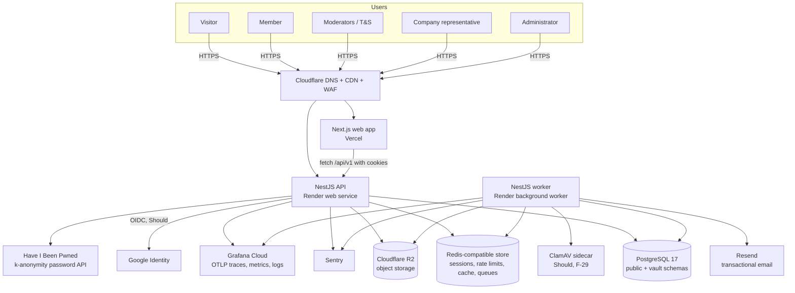
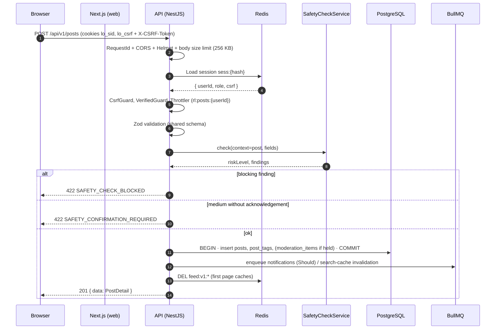
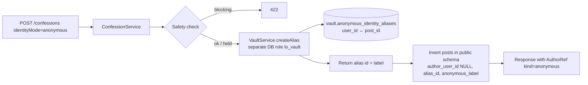
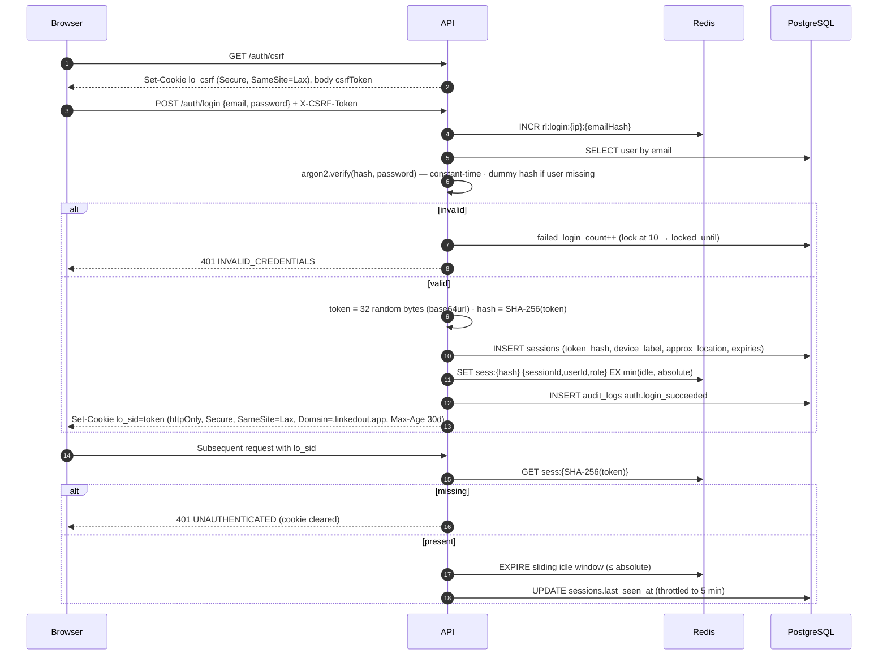
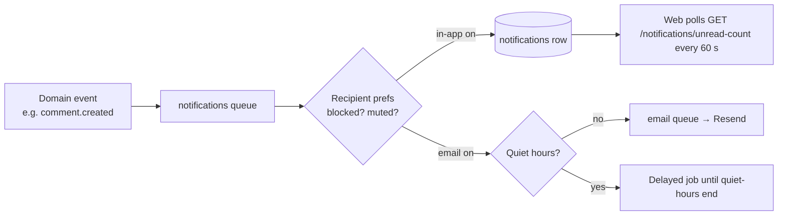
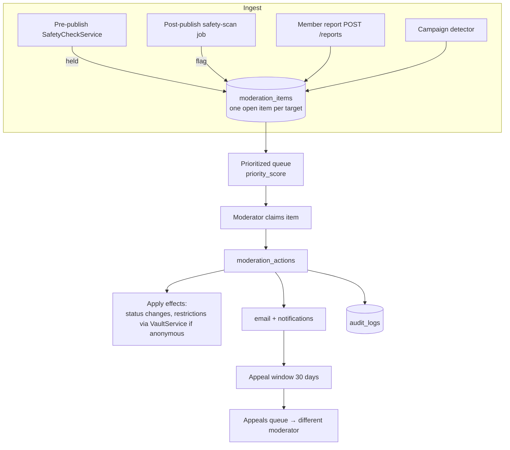
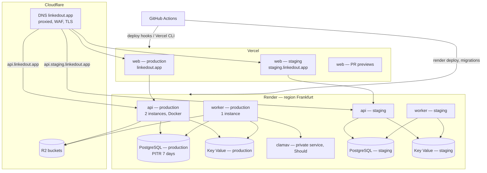

# LinkedOut — Architecture

Related: [TECH_STACK.md](TECH_STACK.md) · [DATABASE_SCHEMA.md](DATABASE_SCHEMA.md) · [API_SPEC.md](API_SPEC.md) · [SECURITY.md](SECURITY.md) · [DEPLOYMENT.md](DEPLOYMENT.md)

## 1. Architectural style

LinkedOut is a **modular monolith** (plan §10). There is one backend codebase (NestJS) deployed as two processes from the same image, plus one frontend (Next.js):

| Process | Entry point | Responsibility |
|---|---|---|
| `web` | `apps/web` (Next.js) | Server-rendered and client UI; calls the API over HTTPS. Holds no business logic or database access. |
| `api` | `apps/api/src/main.ts` | REST API `/api/v1`, synchronous business logic, authorization. |
| `worker` | `apps/api/src/worker.ts` | BullMQ processors: email, notifications, safety scans, media scans, deletion/export, scheduled maintenance. |

Module boundaries are enforced with ESLint (`eslint-plugin-boundaries`). A module exposes only its `*.service.ts` public facade and DTOs through its `index.ts`. Modules never query another module's tables directly. Any module can later be extracted into a service behind the same facade.

## 2. System context

## 3. Components

### 3.1 Frontend (`apps/web`)

| Concern | Design |
|---|---|
| Framework | Next.js 16 App Router, React 19 Server Components for public pages (landing, feed first page, post detail, company pages, profiles) for SEO and fast LCP; Client Components for interactive parts. |
| Data fetching | Server Components call the API with the incoming request's cookies forwarded; Client Components use TanStack Query with a typed API client generated from `packages/shared` Zod schemas. |
| Forms | React Hook Form + Zod resolvers using the same schemas as the API. |
| Styling | Tailwind CSS 4 with design tokens from [UI_UX.md](UI_UX.md); shadcn/ui components built on Radix primitives for accessibility. |
| Auth awareness | `GET /me` fetched in the root layout (server) to decide navigation; `middleware.ts` redirects unauthenticated users away from member routes (UX only — the API enforces authorization). |
| Markdown | Rendered with `react-markdown` + `rehype-sanitize` (allow-list: paragraphs, emphasis, strong, lists, blockquote, code, links with `rel="nofollow ugc noopener"`); no raw HTML. |
| Security headers | Set in `next.config.ts`: CSP with nonces, HSTS, `X-Content-Type-Options`, `Referrer-Policy: strict-origin-when-cross-origin`, `Permissions-Policy` denying camera/mic/geolocation. |

### 3.2 Backend modules (`apps/api/src/modules`)

| Module | Plan module (§10) | Features | Owns tables |
|---|---|---|---|
| `identity` | Identity and Access | F-01, F-02, F-04, F-08, F-09, F-39 | users, sessions, auth_tokens, oauth_accounts, account_deletion_requests, data_export_requests, beta_invites |
| `profile` | Profile | F-03, F-05, F-06 | profiles, profile_lessons, profile_skills, profile_timeline_entries, username_history, reserved_usernames, privacy_settings |
| `content` | Feed and Post | F-10, F-16, F-28 | posts, lesson_details, post_revisions, post_corrections, categories, tags, post_tags, polls, poll_options, poll_votes, industries |
| `feed` | Feed and Post | F-11, F-30, F-35 | topic_follows (read models over posts) |
| `confession` | Confession | F-15 | confession_details (uses `content` facade for posts) |
| `company` | Company Review | F-17, F-25 | companies, workplace_reviews, review_topic_ratings, company_memberships, company_responses |
| `jobreport` | Job Report | F-18 | job_reports |
| `community` | Community | F-26 | communities, community_members, community_rules, community_pinned_resources, community_join_requests |
| `engagement` | Comment and Reaction | F-12, F-13, F-14 | comments, reactions, saved_posts |
| `notification` | Notification | F-27, F-42 | notifications, notification_preferences |
| `search` | Search | F-19 | none (queries via owners' read facades and `tsvector` indexes) |
| `moderation` | Moderation | F-20, F-21, F-22 | reports, moderation_items, moderation_actions, appeals |
| `safety` | Moderation | F-07, F-21 (checks) | blocks, mutes |
| `vault` | (new, from §14 safeguards) | F-23 | `vault.anonymous_identity_aliases`, identity_reveal_requests, staff_permissions |
| `audit` | (cross-cutting) | F-23 | audit_logs |
| `admin` | (cross-cutting) | F-24 | feature_flags (and orchestrates other modules' facades) |
| `media` | (infrastructure) | F-29, F-33 | media, post_media |
| `analytics` | Analytics | F-24 metrics, F-32, F-38 | read-only aggregates; product events are emitted to logs (no third-party tracker in MVP) |

Shared infrastructure (`apps/api/src/common`): configuration (Zod-validated env), Prisma clients (`PrismaService` with role `lo_app`, `VaultPrismaService` with role `lo_vault`), Redis client, queue producers, auth guards (`SessionGuard`, `VerifiedGuard`, `RolesGuard`, `CommunityRoleGuard`, `RepresentativeGuard`, `VaultPermissionGuard`), CSRF guard, throttler, exception filter (standard error format), serializers (public DTO whitelists), request-ID middleware, OpenTelemetry instrumentation, pino logger with redaction.

### 3.3 Data stores

| Store | Use | Notes |
|---|---|---|
| PostgreSQL 17 | System of record; full-text search (`tsvector`, `pg_trgm`) | Render managed PostgreSQL with point-in-time recovery; `vault` schema isolated by DB role. |
| Redis-compatible key-value (Render Key Value, Valkey 8) | Sessions (`sess:*`), rate-limit counters (`rl:*`), visitor feed cache (`feed:v1:*`, 30 s), username availability cache, idempotency keys (`idem:*`, 24 h), BullMQ queues (`bull:*`) | `maxmemory-policy noeviction` (required by BullMQ); persistence enabled. |
| Cloudflare R2 (S3-compatible) | Images (Should), data exports, database backup copies | Buckets: `linkedout-media`, `linkedout-exports` (7-day lifecycle), `linkedout-backups` (separate account credentials). |
| OpenSearch (later) | Search once PostgreSQL search exceeds NFR-P4 | Not deployed in MVP; `search` module facade allows swap. |

### 3.4 External services

| Service | Purpose | Data sent |
|---|---|---|
| Resend | Transactional email | Recipient email, templated content (no anonymous labels in subjects). |
| Have I Been Pwned Pwned Passwords | Breached-password check | First 5 chars of SHA-1 hash only (k-anonymity). |
| Google Identity (Should) | OAuth sign-in | Standard OIDC. |
| MaxMind GeoLite2 (local database file) | Approximate session location | None — lookup is local. |
| Sentry | Error tracking | Scrubbed events (no cookies, bodies, emails). |
| Grafana Cloud | Traces, metrics, logs | Redacted structured logs and spans. |
| ClamAV (self-hosted container, Should) | Malware scanning | Files stay inside the private network. |

### 3.5 AI/ML

No AI/ML in the MVP (plan §17). Automated safety checks are deterministic rules (regular expressions, `libphonenumber-js`, Luhn checks, entropy-based secret detection, curated term lists, velocity rules). AI-assisted categorization (F-36) is Future. It will produce suggestions only and never make final moderation decisions.

## 4. Request lifecycle and data flow

### 4.1 Authenticated write (create post)

### 4.2 Read path (visitor feed)

1. The browser requests `/mess`. The Next.js Server Component calls `GET /api/v1/feed?limit=20` with no cookies.
2. The API checks Redis `feed:v1:latest:{filtersHash}`. On a hit it returns within 30 s of freshness. On a miss it queries `posts_feed_idx` with the keyset `(published_at, id)` and caches the result.
3. For members, the cache is bypassed. The query adds `NOT EXISTS` filters against `blocks` and `mutes`, and the `viewer` fields come from `reactions` and `saved_posts` for the page's post IDs (one batched query each).
4. The HTML is streamed to the browser. TanStack Query hydrates the data and handles infinite scroll with `nextCursor`.

### 4.3 Anonymous confession data flow

The vault insert and the public insert run in different transactions on different connections (different DB roles), so the order is chosen to never leave an anonymous post without an owner:

1. Generate the post ID (UUIDv7) in the application.
2. `VaultService.createAlias(userId, "post", postId)` inserts the vault row and returns `aliasId` and the label.
3. Insert the post with that ID, `alias_id` and `anonymous_label` (satisfies `posts_identity_chk`).
4. If step 3 fails, delete the vault row before responding with the error.
5. A reconciliation job (every 10 minutes) deletes vault rows whose `target_id` has no matching post after 10 minutes, covering crashes between steps 2 and 3.

### 4.4 Logging rules for anonymity

- The pino redaction paths are `req.headers.cookie`, `req.headers["x-csrf-token"]`, `*.email`, `*.password`, `*.token`, `*.userId`, `*.body`, `*.narrative`. Context-specific code paths never log a user ID together with an anonymous target ID.
- Traces do not include user IDs as span attributes on the `confession`, `vault`, `jobreport` and `company` modules.
- Automated tests ([TESTING.md](TESTING.md) SEC-12) assert that the logs captured during a confession flow contain neither the author's user ID nor their username.

## 5. Authentication and session flow

- **Why sessions, not JWT:** revocation is immediate (FR-5), session listing is natural, and there is no token-storage risk in the browser. See [ASSUMPTIONS.md](ASSUMPTIONS.md#3-architecture).
- **Role changes and suspensions:** the API rewrites or deletes affected `sess:*` keys immediately (an index set `user_sessions:{userId}` tracks the keys).
- **Cross-subdomain cookies:** `linkedout.app` (web) and `api.linkedout.app` (API) are same-site, so `SameSite=Lax` cookies are sent on fetches with `credentials: "include"`. CORS allows only `https://linkedout.app` (and the staging and preview origins per environment) with `Access-Control-Allow-Credentials: true`.

## 6. Background jobs and notification design

There is no real-time transport in the MVP (plan §17 rules out real-time chat). The notification count is polled every 60 s. Server-Sent Events are a later option.

| Queue | Producer | Processor | Retry |
|---|---|---|---|
| `email` | All modules | Renders React Email templates; sends via Resend; honors quiet hours by delaying jobs | 5 attempts, exponential backoff from 30 s |
| `notifications` | engagement, community, moderation, company | Creates `notifications` rows, batches reactions per hour (`batch_key`), enqueues `email` per preferences | 5 attempts |
| `safety-scan` | content, confession, company, jobreport | Post-publish re-scan with the latest rules and campaign detection (FR-48) | 3 attempts |
| `media-scan` (Should) | media | Magic-byte check, `sharp` re-encode + EXIF strip, ClamAV scan, update `scan_status` | 3 attempts |
| `account-deletion` | identity | Daily scheduled run: executes due deletion requests (see SECURITY §9) | 10 attempts, then alert |
| `data-export` (Should) | identity | Builds the ZIP, uploads it to `linkedout-exports`, emails a signed link | 3 attempts |
| `maintenance` | cron (BullMQ repeatable jobs) | Purges soft-deleted content (daily 02:00 UTC), draft reminders and expiry (daily), session IP nulling (daily), token cleanup (hourly), theme summary recompute (every 15 min for dirty companies), vault reconciliation (every 10 min), representative membership expiry (daily), audit-log retention (monthly) | — |

Domain events are in-process (NestJS `EventEmitter2`). Handlers only enqueue jobs, so a failure in notifications never fails the user's write.

## 7. Moderation architecture

Priority rules: reasons `harassment_or_threats`, `personal_information`, `illegal_content` and automated findings `threat_terms` or `pii.*` with severity high make an item `high`. `spam` makes it `low`. Everything else is `normal`.

## 8. Deployment architecture

Frankfurt (EU) is chosen for GDPR alignment. Vercel serves the web app from the edge, and server rendering runs in the `fra1` region next to the API. Details are in [DEPLOYMENT.md](DEPLOYMENT.md).

## 9. Scalability plan

The plan says not to claim scalability before testing (§19), so each stage below has a measured trigger.

| Stage | Load (target) | Measures |
|---|---|---|
| MVP | 10k MAU, 500 concurrent, 50 rps | 2 API instances (Render Standard), 1 worker, PostgreSQL 4 GB RAM, Redis 1 GB; keyset pagination; visitor feed cache; denormalized counters; indexes in DATABASE_SCHEMA §5–8. |
| Growth 1 | 50k MAU, 150 rps | Horizontal API autoscaling 2–6 instances (stateless); PgBouncer connection pooling; read replica for search and admin metrics; extend feed cache to category pages. |
| Growth 2 | 100k+ MAU, 300+ rps | Move search to OpenSearch via the `search` facade (indexing worker fed by domain events); split the `worker` by queue; CDN-cache public post pages for 60 s with surrogate keys; partition `audit_logs` and `notifications` by month. |
| Extraction (only if needed) | Team or load justify it | Extract `notification` or `search` into services first (already async and facade-isolated). The vault could move to a separate database instance for stronger isolation. |

**Load test gates** (k6, see [TESTING.md](TESTING.md#6-load-and-performance-tests)) must pass before each stage claim: feed pagination, post creation, comment bursts, search, notification jobs, media upload.

## 10. Failure modes and resilience

| Failure | Behavior |
|---|---|
| Redis unavailable | Authenticated requests return `503` (sessions and rate limits cannot be checked safely); public cached reads fall back to the DB with a stricter in-memory per-instance rate limit. |
| PostgreSQL unavailable | `/health/ready` fails; Render stops routing to the instances; the web app shows the maintenance page (S-38). |
| Email provider down | Jobs retry with backoff; the verification UI offers "Resend" later; alert if the queue age is > 15 min. |
| Worker down | Writes still succeed; jobs accumulate; alert when queue depth is > 500 or the oldest job is > 10 min. |
| Vault connection failure | Confession, review and anonymous job-report creation return `503`; pseudonymous features continue. |
| Bad deploy | Health-check-gated deploys; instant rollback to the previous image (see DEPLOYMENT §9). |
