# Contributing to LinkedOut

Thanks for helping build LinkedOut. Read [CLAUDE.md](../CLAUDE.md) (project conventions, which apply to humans as well as AI tools) and the relevant docs in `/docs` before starting a task.

## 1. Workflow overview

```mermaid
flowchart LR
  A[Pick next task in TASKS.md] --> B[Create branch from main]
  B --> C[Implement + tests + docs]
  C --> D[Commit with Conventional Commits]
  D --> E[Open PR with template]
  E --> F[CI green]
  F --> G[Review + approval]
  G --> H[Squash merge]
  H --> I[Tick task in TASKS.md + CHANGELOG entry]
  I --> J[Auto-deploy to staging]
```



## 2. Branching strategy

Trunk-based development with short-lived branches:

| Branch | Purpose | Rules |
|---|---|---|
| `main` | Always deployable; auto-deploys to staging | Protected; PR + green CI + review required; squash merge only; linear history |
| `feat/<task-id>-<slug>` | New functionality | e.g. `feat/T-045-register-endpoint` |
| `fix/<task-or-issue>-<slug>` | Bug fixes | e.g. `fix/123-feed-cursor-dup` |
| `chore/…`, `docs/…`, `test/…`, `refactor/…`, `ci/…` | Non-feature work | Same naming pattern |
| `hotfix/<slug>` | Urgent production fix | Branch from the latest release tag, PR to `main`, then tag a patch release |

- Keep branches under 2 days old. Split work if it takes longer.
- Rebase on `main` before requesting review (`git pull --rebase origin main`).
- Releases are **tags** on `main` (`vX.Y.Z`). There are no release branches.

## 3. Commit format (Conventional Commits)

```text
<type>(<scope>): <subject in imperative mood, ≤ 72 chars>

<body: what and why, wrapped at 100 chars>

Refs: T-045, FR-1, US-005
```

| Type | Use |
|---|---|
| `feat` | New user-facing functionality |
| `fix` | Bug fix |
| `docs` | Documentation only |
| `test` | Adding or fixing tests |
| `refactor` | Code change without behavior change |
| `perf` | Performance improvement |
| `chore` | Tooling, dependencies, config |
| `ci` | CI/CD workflows |
| `build` | Build system, Dockerfiles |
| `security` | Security hardening without new features |
| `revert` | Reverts a previous commit |

**Scopes:** `web`, `api`, `worker`, `shared`, `ui-tokens`, `email`, `db`, `infra`, `docs`, or an API module (`identity`, `profile`, `content`, `feed`, `confession`, `engagement`, `company`, `jobreport`, `search`, `moderation`, `safety`, `vault`, `audit`, `admin`, `community`, `notification`, `media`).

Examples:
- `feat(identity): add enumeration-safe registration endpoint`
- `fix(feed): prevent duplicate posts across cursor pages`
- `security(vault): deny lo_app role access to vault schema`

Breaking API changes use `!` (`feat(api)!: …`) plus a `BREAKING CHANGE:` footer, and need a v2 plan (API_SPEC §1.6). commitlint enforces this format in the `commit-msg` hook and in CI.

## 4. Pull request process

1. **Open the PR** with the template (`.github/pull_request_template.md`):
   - Summary of the change and the linked task (T-ID), requirements (FR) and stories (US).
   - Screenshots or recordings for UI changes (desktop + mobile).
   - Test evidence (which TC/SEC cases were added or updated).
   - A privacy-impact checkbox: "Does this change add, expose, log or retain personal data or anonymous-content links?" If yes, explain.
   - A migration checkbox: "Backward-compatible (expand/contract)?"
2. **Size:** ≤ 400 changed lines excluding generated files and lockfiles. Larger PRs need a note explaining why.
3. **CI must be green:** lint, typecheck, unit, integration, security/contract, build, E2E, CodeQL, gitleaks, audit.
4. **Reviews:**
   - 1 approval for normal changes.
   - 2 approvals (one from CODEOWNERS) for `apps/api/src/modules/{vault,identity,moderation,safety,audit}`, `apps/api/prisma/migrations`, `infra/`, `.github/workflows/`, `SECURITY.md`.
5. **Merge:** squash merge with a Conventional Commit title. Delete the branch.
6. **After merge:** tick the task in `docs/TASKS.md` and add an *Unreleased* entry to `docs/CHANGELOG.md` (in the same PR when possible).

## 5. Review checklist

**Correctness**
- [ ] Meets the linked story's acceptance criteria.
- [ ] Edge cases from WORKFLOW W-32 are considered.
- [ ] Error responses use the standard format and documented codes.

**Security & privacy**
- [ ] Every new route has an auth guard or an explicit `@Public()`.
- [ ] Ownership/role checks are in the service, using the session identity only.
- [ ] No private fields (email, internal IDs, alias IDs) in public responses; the contract test allow-list was updated deliberately.
- [ ] No user ID logged together with anonymous content; no PII in logs, spans or Sentry events.
- [ ] Inputs validated with shared Zod schemas; free text goes through safety checks where required.
- [ ] Vault data is accessed only through `IdentityVaultService`.
- [ ] Rate limits applied to new write endpoints.

**Data**
- [ ] Migration is reversible by forward fix and backward-compatible with the previous release.
- [ ] Indexes exist for new query patterns; no N+1 queries (batched loaders).
- [ ] Retention/deletion behavior covered for new personal data (SECURITY §9).

**Quality**
- [ ] Unit + integration tests added; coverage thresholds pass.
- [ ] UI: keyboard operable, labelled, contrast tokens used, loading/empty/error states present, copy follows UI_UX C.7.
- [ ] Docs updated if behavior, API, schema or env vars changed (API_SPEC, DATABASE_SCHEMA, ENV_SETUP, …).
- [ ] No dead code, commented-out blocks or stray `console.log`.

## 6. Code style

| Area | Rule |
|---|---|
| Formatting | Prettier (2 spaces, single quotes, trailing commas, 100-column print width); never hand-format against it |
| Linting | ESLint flat config from `packages/eslint-config`; zero warnings policy in CI |
| TypeScript | `strict: true`, `noUncheckedIndexedAccess: true`; no `any` (use `unknown` + narrowing); no non-null assertions except in tests |
| Naming | See CLAUDE.md "Naming rules" |
| Imports | Absolute workspace imports (`@linkedout/shared`); modules import other modules only via their `index.ts` (enforced by `eslint-plugin-boundaries`) |
| Errors | Throw typed domain errors (`DomainError(code, message, details)`) mapped by the global filter; never leak stack traces |
| Async | Always `await` or return promises; no floating promises (lint rule) |
| React | Function components, Server Components by default, `"use client"` only where needed; hooks prefixed `use`; no inline styles (Tailwind tokens) |
| CSS | Tailwind utility classes with design tokens; no raw hex values in components |
| Copy | User-facing strings in `apps/web/src/content/en.json` or `packages/shared/src/copy` |
| Comments | Explain *why*, not *what*; reference requirement IDs for non-obvious rules (`// FR-39: minimum sample`) |
| Tests | Arrange-Act-Assert; descriptive names (`it('returns 404 for held posts to non-authors')`); factories over raw inserts |

## 7. Reporting bugs and security issues

- Bugs: GitHub issue with the bug template (steps, expected, actual, environment, request ID).
- **Security vulnerabilities: never open a public issue.** Email `security@linkedout.app` (see SECURITY §15).

## 8. Code of conduct

Contributors follow the same spirit as the Community Guidelines: be honest, be kind, be witty, never be cruel. Harassment in project spaces is not tolerated.
