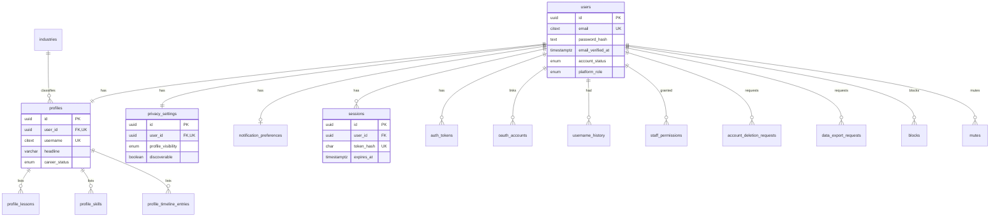
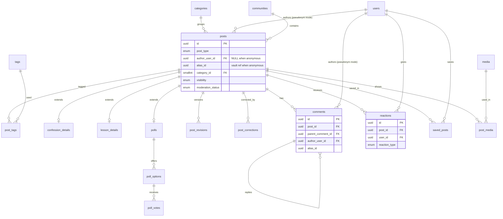
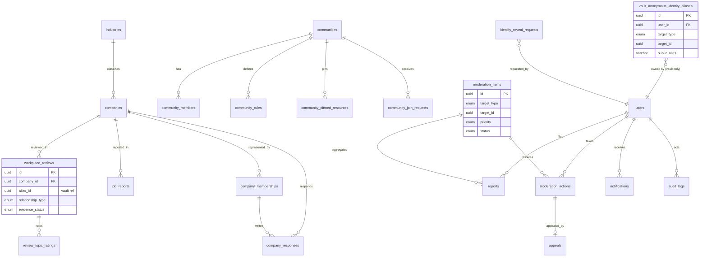

# LinkedOut — Database Schema

| Item | Decision |
|---|---|
| Engine | PostgreSQL 17 |
| ORM / migrations | Prisma 6 (`apps/api/prisma/schema.prisma`, `prisma migrate`), multi-schema enabled |
| Schemas | `public` (application data) and `vault` (identity mappings; restricted role) |
| Primary keys | UUID v7 (`uuid` type, generated in the application) unless stated; small lookup tables use `smallint` identities |
| Timestamps | `timestamptz`, UTC; `created_at` default `now()`, `updated_at` maintained by Prisma `@updatedAt` |
| Soft delete | `deleted_at timestamptz NULL` on user-generated content; purge job hard-deletes after 30 days |
| Case-insensitive text | `citext` extension for emails and usernames |
| Extensions | `citext`, `pg_trgm`, `unaccent` |
| Naming | snake_case plural tables, snake_case columns; Prisma models PascalCase singular mapped with `@@map` |

> Changes to the plan's logical model (§11) are listed in [ASSUMPTIONS.md](ASSUMPTIONS.md#4-database). In short: anonymous authorship moved to the `vault` schema, profile visibility lives only in `privacy_settings`, `company_responses` can target reviews and job reports, and supporting tables were added (sessions, tokens, categories, tags, saves, blocks, mutes, moderation items and others).

---

## 1. Database roles and access

| Role | Used by | Privileges |
|---|---|---|
| `lo_migrator` | CI migration step only | Owner of both schemas; DDL. |
| `lo_app` | API and worker (default Prisma client) | `SELECT, INSERT, UPDATE, DELETE` on `public.*` except `audit_logs` (`SELECT, INSERT` only). **No privileges on `vault`.** |
| `lo_vault` | `IdentityVaultService` (second Prisma client, separate connection string `VAULT_DATABASE_URL`) | `SELECT, INSERT, DELETE` on `vault.*`; `SELECT (id, account_status)` on `public.users`. |
| `lo_readonly` | Admin metrics queries, backups verification | `SELECT` on `public.*` except `sessions`, `auth_tokens`; none on `vault`. |

A trigger `audit_logs_immutable` raises an exception on `UPDATE` or `DELETE` of `public.audit_logs`.

---

## 2. Entity-relationship diagrams

### 2.1 Identity, profile and privacy



### 2.2 Content and engagement



### 2.3 Workplace, communities, safety and vault



---

## 3. Enumerated types

| Enum | Values |
|---|---|
| `account_status` | `pending_verification`, `active`, `restricted`, `suspended`, `deletion_pending`, `deleted` |
| `platform_role` | `member`, `platform_moderator`, `admin` |
| `staff_permission` | `identity_vault.reveal` |
| `auth_token_purpose` | `email_verification`, `password_reset`, `representative_email_verification` |
| `oauth_provider` | `google` |
| `career_status` | `exploring`, `studying`, `employed`, `open_to_escape`, `between_jobs`, `career_changing`, `prefer_not_to_say` |
| `profile_visibility` | `public`, `members`, `hidden` |
| `identity_mode` | `pseudonym`, `anonymous` |
| `message_permission` | `everyone`, `requests_only`, `nobody` |
| `post_type` | `story`, `advice`, `lesson`, `confession`, `poll`, `meme` |
| `desired_response` | `support`, `advice`, `discussion`, `just_sharing` |
| `content_visibility` | `public`, `members`, `community` |
| `publication_status` | `draft`, `published` |
| `moderation_status` | `clear`, `held`, `limited`, `removed` |
| `content_warning` | `burnout`, `harassment`, `discrimination`, `job_loss`, `mental_health`, `strong_language`, `other` |
| `reaction_type` | `im_dead`, `pain`, `same_here`, `melting`, `corporate_circus`, `survived` |
| `confession_experience_type` | `management`, `workload_overtime`, `pay_issue`, `workplace_conflict`, `discrimination_harassment`, `layoff`, `mistake`, `ethics_concern`, `internship`, `other` |
| `company_page_status` | `pending`, `active`, `rejected`, `merged`, `suspended` |
| `review_relationship` | `current_employee`, `former_employee`, `applicant`, `intern`, `other` |
| `review_topic` | `work_life_balance`, `management`, `communication`, `compensation`, `career_growth` |
| `evidence_status` | `unverified`, `verified` |
| `job_report_type` | `misleading_job_description`, `unclear_salary_or_benefits`, `interview_process_problems`, `candidate_ghosting`, `unpaid_test_assignment`, `unexpected_work_requirements`, `offer_changed_or_withdrawn`, `positive_hiring_experience` |
| `interview_stage` | `application`, `screening`, `technical`, `onsite`, `final`, `offer` |
| `job_report_outcome` | `rejected`, `ghosted`, `withdrew`, `offer_declined`, `offer_accepted`, `offer_rescinded`, `still_waiting` |
| `role_category` | `software_engineering`, `data`, `design`, `product`, `marketing`, `sales`, `operations`, `finance`, `hr`, `customer_support`, `internship`, `other` |
| `membership_status` | `pending_email`, `pending_review`, `verified`, `rejected`, `revoked`, `expired` |
| `community_visibility` | `public`, `private` |
| `community_role` | `member`, `moderator`, `owner` |
| `join_request_status` | `pending`, `approved`, `declined` |
| `report_target_type` | `post`, `comment`, `profile`, `workplace_review`, `job_report`, `company_response`, `community` |
| `report_reason` | `personal_information`, `harassment_or_threats`, `false_or_manipulated`, `confidential_information`, `spam`, `impersonation`, `discrimination_or_hate`, `illegal_content`, `other_policy_violation` |
| `report_status` | `open`, `actioned`, `no_violation`, `duplicate` |
| `moderation_target_type` | all `report_target_type` values + `review_campaign` |
| `moderation_priority` | `high`, `normal`, `low` |
| `moderation_item_status` | `open`, `in_review`, `escalated`, `resolved` |
| `moderation_action_type` | `no_action`, `request_edits`, `add_content_warning`, `limit_visibility`, `remove_content`, `restrict_posting`, `suspend_account`, `escalate` |
| `moderation_scope` | `platform`, `community` |
| `appeal_status` | `pending`, `upheld`, `reversed`, `modified` |
| `reveal_category` | `credible_threat`, `legal_order`, `repeat_abuse_ban_evasion` |
| `reveal_status` | `pending_approval`, `approved`, `rejected`, `expired` |
| `notification_type` | `comment_on_post`, `reply_to_comment`, `reactions_on_post`, `community_invitation`, `community_announcement`, `report_update`, `moderation_decision`, `followed_topic_digest`, `company_response` |
| `media_scan_status` | `pending`, `clean`, `infected`, `failed` |
| `media_purpose` | `post_image`, `avatar` |
| `job_status` | `pending`, `processing`, `completed`, `cancelled`, `failed` |
| `alias_target_type` (vault) | `post`, `job_report`, `workplace_review` |

---

## 4. Tables — Identity, profile and privacy (`public`)

### 4.1 `users` — private account identity (F-01)
| Column | Type | Constraints | Notes |
|---|---|---|---|
| id | uuid | PK | Internal only — never exposed in public APIs. |
| email | citext | NOT NULL, UNIQUE | Private. |
| password_hash | text | NULL | Argon2id PHC string; NULL for OAuth-only accounts. |
| email_verified_at | timestamptz | NULL | |
| account_status | account_status | NOT NULL, default `pending_verification` | |
| platform_role | platform_role | NOT NULL, default `member` | |
| age_confirmed_at | timestamptz | NOT NULL | User confirmed age ≥ 16; DOB is not stored. |
| terms_version | varchar(20) | NOT NULL | e.g. `2027-03-01`. |
| terms_accepted_at | timestamptz | NOT NULL | |
| onboarding_completed_at | timestamptz | NULL | Required before first publish. |
| posting_restricted_until | timestamptz | NULL | Set by `restrict_posting` action. |
| failed_login_count | smallint | NOT NULL, default 0 | Reset on success. |
| locked_until | timestamptz | NULL | Brute-force lockout. |
| last_login_at | timestamptz | NULL | |
| created_at / updated_at | timestamptz | NOT NULL | |
| deleted_at | timestamptz | NULL | Set when deletion completes (row becomes a tombstone with email replaced by `deleted+{id}@invalid`). |

Indexes: `users_email_key` (unique), `users_account_status_idx (account_status)`, `users_created_at_idx (created_at)`.

### 4.2 `oauth_accounts` (F-02, Should)
| Column | Type | Constraints |
|---|---|---|
| id | uuid | PK |
| user_id | uuid | FK → users.id ON DELETE CASCADE, NOT NULL |
| provider | oauth_provider | NOT NULL |
| provider_subject | varchar(255) | NOT NULL |
| created_at | timestamptz | NOT NULL |

Indexes: UNIQUE `(provider, provider_subject)`; `(user_id)`.

### 4.3 `sessions` (F-01)
| Column | Type | Constraints | Notes |
|---|---|---|---|
| id | uuid | PK | Exposed to the owner only, as `sessionId`. |
| user_id | uuid | FK → users.id ON DELETE CASCADE, NOT NULL | |
| token_hash | char(64) | NOT NULL, UNIQUE | SHA-256 of the 256-bit random session token; the raw token is only in the cookie. |
| device_label | varchar(100) | NOT NULL | Derived from User-Agent, e.g. "Firefox on Linux". |
| user_agent | varchar(500) | NULL | |
| ip_address | inet | NULL | Nulled after 90 days by retention job. |
| approx_location | varchar(100) | NULL | City/country from IP at login (MaxMind GeoLite2), never more precise. |
| created_at | timestamptz | NOT NULL | |
| last_seen_at | timestamptz | NOT NULL | Updated at most once per 5 minutes. |
| idle_expires_at | timestamptz | NOT NULL | `last_seen_at + 14 days`. |
| absolute_expires_at | timestamptz | NOT NULL | `created_at + 30 days`. |
| revoked_at | timestamptz | NULL | |

Indexes: `(user_id, revoked_at)`, `(absolute_expires_at)`. Redis mirror: `sess:{token_hash}` → `{sessionId, userId, role, csrfToken}` with TTL = min(idle, absolute).

### 4.4 `auth_tokens` (F-01, F-25)
| Column | Type | Constraints | Notes |
|---|---|---|---|
| id | uuid | PK | |
| user_id | uuid | FK → users.id ON DELETE CASCADE, NOT NULL | |
| purpose | auth_token_purpose | NOT NULL | |
| token_hash | char(64) | NOT NULL, UNIQUE | SHA-256 of emailed token. |
| metadata | jsonb | NOT NULL default `{}` | e.g. `{ "companyMembershipId": "…" }`. |
| expires_at | timestamptz | NOT NULL | 24 h verification, 60 min reset. |
| used_at | timestamptz | NULL | |
| created_at | timestamptz | NOT NULL | |

Indexes: `(user_id, purpose, created_at DESC)`, `(expires_at)`.

### 4.5 `profiles` — public identity (F-03, F-05)
| Column | Type | Constraints | Notes |
|---|---|---|---|
| id | uuid | PK | |
| user_id | uuid | FK → users.id ON DELETE CASCADE, NOT NULL, UNIQUE | |
| username | citext | NOT NULL, UNIQUE, CHECK `username ~ '^[a-z0-9_]{3,30}$'` | Public handle. |
| display_name | varchar(50) | NULL | Optional pseudonymous display name. |
| headline | varchar(120) | NULL | |
| bio | varchar(600) | NULL | |
| industry_id | smallint | FK → industries.id, NULL | |
| broad_location | char(2) | NULL | ISO 3166-1 alpha-2 country code only. |
| career_status | career_status | NULL | |
| avatar_media_id | uuid | FK → media.id ON DELETE SET NULL, NULL | Should (F-29); monogram avatar otherwise. |
| username_changed_at | timestamptz | NULL | Enforces 30-day rule. |
| created_at / updated_at | timestamptz | NOT NULL | |

Indexes: `profiles_username_key` (unique), `profiles_username_trgm_idx` GIN (`username gin_trgm_ops`) for member search.

### 4.6 `profile_lessons`, `profile_skills`, `profile_timeline_entries` (F-05)
| Table | Columns | Constraints |
|---|---|---|
| profile_lessons | id uuid PK; profile_id uuid FK → profiles ON DELETE CASCADE; body varchar(280) NOT NULL; position smallint NOT NULL; created_at | UNIQUE `(profile_id, position)`; max 10 per profile (service rule). |
| profile_skills | id uuid PK; profile_id uuid FK; name varchar(50) NOT NULL; normalized_name varchar(50) NOT NULL; position smallint | UNIQUE `(profile_id, normalized_name)`; max 20. |
| profile_timeline_entries | id uuid PK; profile_id uuid FK; start_year smallint NOT NULL CHECK 1950–2100; start_month smallint NULL CHECK 1–12; end_year smallint NULL; end_month smallint NULL; role_category role_category NOT NULL; industry_id smallint FK NULL; note varchar(280) NULL; position smallint | CHECK end ≥ start; max 20. Index `(profile_id, start_year DESC)`. |

### 4.7 `username_history` and `reserved_usernames` (F-03)
| Table | Columns | Constraints |
|---|---|---|
| username_history | id uuid PK; user_id uuid FK → users ON DELETE CASCADE; username citext NOT NULL; changed_at timestamptz NOT NULL; reserved_until timestamptz NOT NULL | Index `(username)`, `(user_id)`. Retained 2 years for moderation (impersonation checks). |
| reserved_usernames | username citext PK; reason varchar(100) NOT NULL | Seeded: admin, administrator, moderator, mod, linkedout, support, help, official, staff, security, privacy, legal, api, root, system, anonymous, deleted. |

### 4.8 `privacy_settings` (F-06)
| Column | Type | Constraints | Default |
|---|---|---|---|
| id | uuid | PK | |
| user_id | uuid | FK → users ON DELETE CASCADE, UNIQUE, NOT NULL | |
| profile_visibility | profile_visibility | NOT NULL | `public` |
| discoverable | boolean | NOT NULL | `true` |
| default_confession_identity | identity_mode | NOT NULL | `anonymous` |
| default_post_visibility | content_visibility | NOT NULL, CHECK in (`public`,`members`) | `public` |
| message_permissions | message_permission | NOT NULL | `requests_only` |
| created_at / updated_at | timestamptz | NOT NULL | |

### 4.9 `notification_preferences` (F-27, Should)
| Column | Type | Constraints | Notes |
|---|---|---|---|
| user_id | uuid | PK, FK → users ON DELETE CASCADE | |
| in_app | jsonb | NOT NULL | Map `notification_type → boolean`; default all `true`. |
| email | jsonb | NOT NULL | Default: `comment_on_post`, `reply_to_comment`, `moderation_decision`, `report_update`, `company_response` true; others false. `moderation_decision` cannot be false (service rule). |
| quiet_hours_start | time | NULL | |
| quiet_hours_end | time | NULL | |
| timezone | varchar(64) | NOT NULL default `UTC` | IANA zone. |
| updated_at | timestamptz | NOT NULL | |

### 4.10 `blocks` and `mutes` (F-07)
| Table | Columns | Constraints |
|---|---|---|
| blocks | id uuid PK; blocker_user_id uuid FK → users ON DELETE CASCADE NOT NULL; blocked_user_id uuid FK → users ON DELETE CASCADE NULL; blocked_alias_id uuid NULL (vault alias id, no FK); created_at | CHECK exactly one of blocked_user_id / blocked_alias_id; UNIQUE `(blocker_user_id, blocked_user_id)`, UNIQUE `(blocker_user_id, blocked_alias_id)`; index `(blocked_user_id)`. |
| mutes | id uuid PK; user_id uuid FK NOT NULL; muted_user_id uuid FK NULL; category_id smallint FK NULL; tag_id uuid FK NULL; created_at | CHECK exactly one target; UNIQUE per (user, target). Index `(user_id)`. |

### 4.11 `staff_permissions` (F-23)
| Column | Type | Constraints |
|---|---|---|
| id | uuid | PK |
| user_id | uuid | FK → users, NOT NULL |
| permission | staff_permission | NOT NULL |
| granted_by_user_id | uuid | FK → users, NOT NULL |
| granted_at | timestamptz | NOT NULL |
| revoked_at | timestamptz | NULL |

Partial UNIQUE `(user_id, permission) WHERE revoked_at IS NULL`.

### 4.12 `account_deletion_requests` (F-08) and `data_export_requests` (F-09)
| Table | Columns | Constraints |
|---|---|---|
| account_deletion_requests | id uuid PK; user_id uuid FK NOT NULL; status job_status NOT NULL; requested_at; scheduled_for timestamptz NOT NULL (= requested_at + 30 days); cancelled_at NULL; completed_at NULL | Partial UNIQUE `(user_id) WHERE status = 'pending'`; index `(status, scheduled_for)`. |
| data_export_requests | id uuid PK; user_id uuid FK NOT NULL; status job_status; storage_key varchar(255) NULL; expires_at NULL; created_at; completed_at NULL | Partial UNIQUE `(user_id) WHERE status IN ('pending','processing')`. |

---

## 5. Tables — Content and engagement (`public`)

### 5.1 `categories` and `industries`
| Table | Columns | Constraints |
|---|---|---|
| categories | id smallint identity PK; slug varchar(60) UNIQUE NOT NULL; name varchar(60) NOT NULL; description varchar(240); position smallint NOT NULL; is_archived boolean default false; created_at | Seeded with the 12 plan categories (see §9). |
| industries | id smallint identity PK; slug varchar(60) UNIQUE; name varchar(80) | Seeded list of 20 industries (technology, finance, healthcare, education, retail, manufacturing, media, consulting, government, nonprofit, hospitality, logistics, telecom, energy, legal, real-estate, automotive, gaming, agriculture, other). |

### 5.2 `tags` and `post_tags` (F-10)
| Table | Columns | Constraints |
|---|---|---|
| tags | id uuid PK; slug varchar(40) UNIQUE NOT NULL (lowercase, `[a-z0-9-]`); name varchar(40); usage_count integer default 0; created_at | Trigram index on slug for autocomplete. |
| post_tags | post_id uuid FK → posts ON DELETE CASCADE; tag_id uuid FK → tags ON DELETE CASCADE | PK `(post_id, tag_id)`; index `(tag_id, post_id)`; max 5 per post. |

### 5.3 `posts` (F-10, F-11, F-15, F-16, F-28, F-29)
| Column | Type | Constraints | Notes |
|---|---|---|---|
| id | uuid | PK | Exposed as `postId` / `confessionId`. |
| post_type | post_type | NOT NULL | |
| identity_mode | identity_mode | NOT NULL default `pseudonym` | `anonymous` only allowed when `post_type = 'confession'`. |
| author_user_id | uuid | FK → users ON DELETE CASCADE, NULL | NOT NULL iff `identity_mode = 'pseudonym'`. |
| alias_id | uuid | NULL | Points to `vault.anonymous_identity_aliases.id`; NOT NULL iff anonymous. No FK (cross-schema privilege boundary). |
| anonymous_label | varchar(60) | NULL | Display label, e.g. `Anonymous Stapler #4821`. |
| community_id | uuid | FK → communities ON DELETE SET NULL, NULL | Should (F-26). |
| category_id | smallint | FK → categories, NOT NULL | |
| title | varchar(150) | NOT NULL | |
| body | text | NOT NULL, CHECK `char_length(body) BETWEEN 1 AND 20000` | Markdown subset; sanitized at render. For `lesson` posts holds the generated summary (what I learned). |
| desired_response | desired_response | NOT NULL | |
| language | varchar(8) | NOT NULL default `en` | BCP-47 primary tag. |
| visibility | content_visibility | NOT NULL default `public` | `community` only with community_id. |
| publication_status | publication_status | NOT NULL default `published` | `draft` only for confessions (private draft mode). |
| moderation_status | moderation_status | NOT NULL default `clear` | |
| content_warnings | content_warning[] | NOT NULL default `{}` | |
| is_long_form | boolean | GENERATED ALWAYS AS (`char_length(body) > 3000`) STORED | |
| reaction_counts | jsonb | NOT NULL default all six types = 0 | Denormalized, updated in the reaction transaction. |
| comment_count | integer | NOT NULL default 0 | Visible comments only. |
| pinned_comment_id | uuid | FK → comments ON DELETE SET NULL, NULL | Must be author's own comment (service rule). |
| search_vector | tsvector | GENERATED (`setweight(to_tsvector('simple', unaccent(title)),'A') || setweight(to_tsvector('simple', unaccent(body)),'B')`) STORED | `simple` config to support multiple languages. |
| published_at | timestamptz | NULL | Set on publish or held-approval. |
| edited_at | timestamptz | NULL | |
| last_activity_at | timestamptz | NOT NULL | Draft expiry (180 days). |
| created_at / updated_at | timestamptz | NOT NULL | |
| deleted_at | timestamptz | NULL | |

CHECK constraints:
- `posts_identity_chk`: `(identity_mode = 'pseudonym' AND author_user_id IS NOT NULL AND alias_id IS NULL AND anonymous_label IS NULL) OR (identity_mode = 'anonymous' AND author_user_id IS NULL AND alias_id IS NOT NULL AND anonymous_label IS NOT NULL AND post_type = 'confession')`
- `posts_draft_chk`: `publication_status = 'published' OR post_type = 'confession'`
- `posts_community_visibility_chk`: `visibility <> 'community' OR community_id IS NOT NULL`

Indexes:
| Name | Definition | Purpose |
|---|---|---|
| posts_feed_idx | `(published_at DESC, id DESC) WHERE publication_status='published' AND moderation_status='clear' AND deleted_at IS NULL` | Latest feed cursor pagination. |
| posts_category_feed_idx | `(category_id, published_at DESC, id DESC)` with same predicate | Category filter. |
| posts_type_feed_idx | `(post_type, published_at DESC, id DESC)` with same predicate | Lessons, confessions listings. |
| posts_author_idx | `(author_user_id, created_at DESC)` | Profile posts, My Damage. |
| posts_alias_idx | `(alias_id)` | Alias block filtering, OP badge. |
| posts_community_idx | `(community_id, published_at DESC)` | Community feed. |
| posts_search_idx | GIN `(search_vector)` | Search. |
| posts_moderation_idx | `(moderation_status) WHERE moderation_status <> 'clear'` | Moderation views. |

### 5.4 `confession_details` (F-15)
| Column | Type | Constraints |
|---|---|---|
| post_id | uuid | PK, FK → posts ON DELETE CASCADE |
| experience_type | confession_experience_type | NOT NULL |
| industry_id | smallint | FK → industries, NULL |
| broad_region | char(2) | NULL (ISO country) |
| period_year | smallint | NULL, CHECK 1970–2100 |
| period_quarter | smallint | NULL, CHECK 1–4; requires period_year |

### 5.5 `lesson_details` (F-16)
| Column | Type | Constraints |
|---|---|---|
| post_id | uuid | PK, FK → posts ON DELETE CASCADE |
| what_i_did_wrong | varchar(3000) | NULL |
| what_happened | varchar(3000) | NULL |
| what_i_learned | varchar(3000) | NOT NULL |
| what_id_do_differently | varchar(3000) | NULL |
| advice | varchar(3000) | NULL |
| links | jsonb | NOT NULL default `[]`; array of `{title ≤ 100, url https only}`, max 5 |

### 5.6 `post_revisions` and `post_corrections` (F-10, F-15)
| Table | Columns | Constraints |
|---|---|---|
| post_revisions | id uuid PK; post_id uuid FK ON DELETE CASCADE; title varchar(150); body text; created_at | Index `(post_id, created_at DESC)`. Visible to moderators only. Purged with post. |
| post_corrections | id uuid PK; post_id uuid FK ON DELETE CASCADE; body varchar(1000) NOT NULL; created_at; removed_by_moderator_at timestamptz NULL | Max 5 per post; index `(post_id, created_at)`. |

### 5.7 `comments` (F-12)
| Column | Type | Constraints | Notes |
|---|---|---|---|
| id | uuid | PK | |
| post_id | uuid | FK → posts ON DELETE CASCADE, NOT NULL | |
| parent_comment_id | uuid | FK → comments ON DELETE SET NULL, NULL | |
| depth | smallint | NOT NULL, CHECK 0–2 | Replies beyond depth 2 attach to the depth-2 ancestor. |
| identity_mode | identity_mode | NOT NULL default `pseudonym` | `anonymous` only when the commenter owns the anonymous post (OP). |
| author_user_id | uuid | FK → users ON DELETE CASCADE, NULL | NOT NULL iff pseudonym. |
| alias_id | uuid | NULL | Equal to the post's alias_id when OP comments anonymously. |
| body | varchar(5000) | NOT NULL | |
| content_warnings | content_warning[] | NOT NULL default `{}` | |
| moderation_status | moderation_status | NOT NULL default `clear` | |
| edited_at | timestamptz | NULL | |
| created_at / updated_at | timestamptz | NOT NULL | |
| deleted_at | timestamptz | NULL | Shown as "[deleted]" if it has replies. |

CHECK `comments_identity_chk` mirrors posts. Indexes: `(post_id, created_at)`, `(parent_comment_id)`, `(author_user_id, created_at DESC)`.

### 5.8 `reactions` (F-13)
| Column | Type | Constraints |
|---|---|---|
| id | uuid | PK |
| post_id | uuid | FK → posts ON DELETE CASCADE, NOT NULL |
| user_id | uuid | FK → users ON DELETE CASCADE, NOT NULL |
| reaction_type | reaction_type | NOT NULL |
| created_at / updated_at | timestamptz | NOT NULL |

UNIQUE `(post_id, user_id)` — one reaction per member per post. Index `(user_id)`.

### 5.9 `saved_posts` (F-14)
| Column | Type | Constraints |
|---|---|---|
| user_id | uuid | FK → users ON DELETE CASCADE |
| post_id | uuid | FK → posts ON DELETE CASCADE |
| created_at | timestamptz | NOT NULL |

PK `(user_id, post_id)`; index `(user_id, created_at DESC)`.

### 5.10 `polls`, `poll_options`, `poll_votes` (F-28, Should)
| Table | Columns | Constraints |
|---|---|---|
| polls | post_id uuid PK FK → posts ON DELETE CASCADE; closes_at timestamptz NOT NULL; total_votes integer default 0 | closes_at between 1 and 14 days after publish. |
| poll_options | id uuid PK; post_id uuid FK → polls ON DELETE CASCADE; label varchar(100) NOT NULL; position smallint; vote_count integer default 0 | 2–6 per poll; UNIQUE `(post_id, position)`. |
| poll_votes | post_id uuid FK; user_id uuid FK; option_id uuid FK → poll_options; created_at | PK `(post_id, user_id)`. Never returned by any API. |

### 5.11 `media` and `post_media` (F-29, Should)
| Table | Columns | Constraints |
|---|---|---|
| media | id uuid PK; owner_user_id uuid FK ON DELETE CASCADE; purpose media_purpose; storage_key varchar(255) UNIQUE; mime_type varchar(50) CHECK in (`image/jpeg`,`image/png`,`image/webp`,`image/gif`); size_bytes integer CHECK ≤ 5,242,880; width smallint; height smallint; alt_text varchar(500); scan_status media_scan_status default `pending`; moderation_status moderation_status default `clear`; created_at | Index `(owner_user_id)`, `(scan_status) WHERE scan_status='pending'`. |
| post_media | post_id uuid FK ON DELETE CASCADE; media_id uuid FK ON DELETE CASCADE; position smallint | PK `(post_id, media_id)`; max 4 per post. |

---

## 6. Tables — Workplace and recruitment (`public`)

### 6.1 `companies` (F-17)
| Column | Type | Constraints | Notes |
|---|---|---|---|
| id | uuid | PK | |
| name | varchar(120) | NOT NULL | |
| normalized_name | varchar(120) | NOT NULL | lowercase, unaccented, legal suffixes removed (inc, ltd, llc, pvt, gmbh, plc). |
| slug | varchar(140) | NOT NULL, UNIQUE | |
| industry_id | smallint | FK → industries, NULL | |
| official_website | varchar(255) | NULL | https URL. |
| website_domain | varchar(255) | NULL | Registrable domain, e.g. `example.com`. |
| website_confirmed | boolean | NOT NULL default false | Set by admin; shown only if true. |
| description | varchar(2000) | NULL | Neutral, admin-edited. |
| page_status | company_page_status | NOT NULL default `pending` | |
| merged_into_company_id | uuid | FK → companies, NULL | |
| submitted_by_user_id | uuid | FK → users ON DELETE SET NULL, NULL | |
| review_count | integer | NOT NULL default 0 | Approved, visible reviews. |
| theme_summary | jsonb | NOT NULL default `{}` | Cached per topic: `{ n, median, distribution[1..5] }` only when n ≥ 5 (24-month window). |
| summaries_paused | boolean | NOT NULL default false | Set by campaign detection (FR-48). |
| approved_at | timestamptz | NULL | |
| created_at / updated_at | timestamptz | NOT NULL | |

Indexes: UNIQUE `(normalized_name) WHERE page_status IN ('pending','active')`; UNIQUE `(website_domain) WHERE website_domain IS NOT NULL AND page_status IN ('pending','active')`; GIN `(normalized_name gin_trgm_ops)`; `(page_status)`.

### 6.2 `workplace_reviews` (F-17)
| Column | Type | Constraints | Notes |
|---|---|---|---|
| id | uuid | PK | |
| company_id | uuid | FK → companies ON DELETE CASCADE, NOT NULL | |
| alias_id | uuid | NOT NULL | Vault alias; reviews are always anonymous to members and companies. |
| relationship_type | review_relationship | NOT NULL | |
| period_start_year | smallint | NOT NULL | |
| period_end_year | smallint | NULL | NULL = present. |
| title | varchar(150) | NOT NULL | |
| narrative | text | NOT NULL, CHECK length 150–10000 | |
| firsthand_attested | boolean | NOT NULL, CHECK = true | |
| display_consent | boolean | NOT NULL | If false the narrative is never returned publicly. |
| evidence_status | evidence_status | NOT NULL default `unverified` | |
| moderation_status | moderation_status | NOT NULL default `clear` | Reviews for `pending` companies stay unpublished until approval. |
| author_account_age_days | smallint | NOT NULL | Coarse value at submission for campaign detection. |
| search_vector | tsvector | GENERATED from title + narrative | |
| published_at | timestamptz | NULL | |
| created_at / updated_at / deleted_at | timestamptz | | |

Indexes: `(company_id, published_at DESC)`, GIN `(search_vector)`, `(company_id, created_at)` for velocity checks. One active review per user per company is enforced in the vault (`scope_key = 'review:{companyId}'`).

### 6.3 `review_topic_ratings` (F-17)
| Column | Type | Constraints |
|---|---|---|
| review_id | uuid | FK → workplace_reviews ON DELETE CASCADE |
| topic | review_topic | NOT NULL |
| rating | smallint | NOT NULL, CHECK 1–5 |

PK `(review_id, topic)`; index `(topic)`.

### 6.4 `job_reports` (F-18)
| Column | Type | Constraints |
|---|---|---|
| id | uuid | PK |
| company_id | uuid | FK → companies ON DELETE CASCADE, NOT NULL |
| identity_mode | identity_mode | NOT NULL default `anonymous` |
| author_user_id | uuid | FK → users ON DELETE CASCADE, NULL (NOT NULL iff pseudonym) |
| alias_id | uuid | NULL (NOT NULL iff anonymous) |
| anonymous_label | varchar(60) | NULL |
| role_category | role_category | NOT NULL |
| report_type | job_report_type | NOT NULL |
| experience_month | date | NOT NULL, CHECK day = 1 and not in future |
| stage_reached | interview_stage | NOT NULL |
| outcome | job_report_outcome | NULL |
| narrative | text | NOT NULL, CHECK length 100–8000 |
| visibility | content_visibility | NOT NULL default `public`, CHECK in (`public`,`members`) |
| moderation_status | moderation_status | NOT NULL default `clear` |
| search_vector | tsvector | GENERATED from narrative |
| published_at / created_at / updated_at / deleted_at | timestamptz | |

Indexes: `(company_id, published_at DESC)`, `(report_type, published_at DESC)`, `(published_at DESC, id DESC)`, GIN `(search_vector)`.

### 6.5 `company_memberships` (F-25, Should)
| Column | Type | Constraints |
|---|---|---|
| id | uuid | PK |
| company_id | uuid | FK → companies ON DELETE CASCADE |
| user_id | uuid | FK → users ON DELETE CASCADE |
| role | varchar(20) | NOT NULL default `representative` |
| job_title | varchar(100) | NOT NULL |
| work_email_domain | varchar(255) | NOT NULL — the full work email is used only to send the verification link and is not stored |
| work_email_verified_at | timestamptz | NULL |
| verification_status | membership_status | NOT NULL default `pending_email` |
| decided_by_user_id | uuid | FK → users, NULL |
| verified_at / expires_at | timestamptz | NULL |
| created_at | timestamptz | NOT NULL |

Partial UNIQUE `(company_id, user_id) WHERE verification_status IN ('pending_email','pending_review','verified')`.

### 6.6 `company_responses` (F-25, Should)
| Column | Type | Constraints |
|---|---|---|
| id | uuid | PK |
| company_id | uuid | FK → companies ON DELETE CASCADE |
| company_membership_id | uuid | FK → company_memberships |
| target_type | varchar(20) | CHECK in (`workplace_review`,`job_report`) |
| target_id | uuid | NOT NULL |
| response_body | varchar(3000) | NOT NULL |
| moderation_status | moderation_status | default `clear` |
| created_at / updated_at / deleted_at | timestamptz | |

UNIQUE `(company_id, target_type, target_id) WHERE deleted_at IS NULL`.

---

## 7. Tables — Communities (`public`, F-26, Should)

| Table | Columns | Constraints / indexes |
|---|---|---|
| communities | id uuid PK; slug varchar(60) UNIQUE; name varchar(80) NOT NULL; description varchar(1000); visibility community_visibility default `public`; owner_user_id uuid FK → users; member_count integer default 0; created_at; updated_at; archived_at NULL | Trigram index on name; max 3 owned per user (service rule). |
| community_members | community_id uuid FK ON DELETE CASCADE; user_id uuid FK ON DELETE CASCADE; role community_role default `member`; joined_at; banned_at NULL | PK `(community_id, user_id)`; index `(user_id)`. |
| community_rules | id uuid PK; community_id uuid FK; position smallint; title varchar(100); body varchar(500) | UNIQUE `(community_id, position)`; max 10. |
| community_pinned_resources | id uuid PK; community_id uuid FK; title varchar(100); url varchar(500) https; position smallint; created_by_user_id uuid FK | Max 5. |
| community_join_requests | id uuid PK; community_id uuid FK; user_id uuid FK; message varchar(500) NULL; status join_request_status default `pending`; created_at; decided_at NULL; decided_by_user_id NULL | Partial UNIQUE `(community_id, user_id) WHERE status='pending'`. |
| topic_follows (F-30) | id uuid PK; user_id uuid FK; category_id smallint FK NULL; tag_id uuid FK NULL; created_at | CHECK exactly one; UNIQUE per target. |

---

## 8. Tables — Safety, moderation, audit and notifications

### 8.1 `reports` (F-20)
| Column | Type | Constraints |
|---|---|---|
| id | uuid | PK |
| reporter_user_id | uuid | FK → users ON DELETE SET NULL |
| target_type | report_target_type | NOT NULL |
| target_id | uuid | NOT NULL |
| reason | report_reason | NOT NULL |
| details | varchar(1000) | NULL |
| status | report_status | NOT NULL default `open` |
| moderation_item_id | uuid | FK → moderation_items, NOT NULL |
| created_at / resolved_at | timestamptz | |

UNIQUE `(reporter_user_id, target_type, target_id)`; index `(moderation_item_id)`, `(reporter_user_id, created_at DESC)`.

### 8.2 `moderation_items` (F-21)
| Column | Type | Constraints | Notes |
|---|---|---|---|
| id | uuid | PK | |
| target_type | moderation_target_type | NOT NULL | |
| target_id | uuid | NOT NULL | For `review_campaign`, the company id. |
| scope | moderation_scope | NOT NULL default `platform` | |
| community_id | uuid | FK → communities, NULL | |
| priority | moderation_priority | NOT NULL | |
| priority_score | integer | NOT NULL | high = 1000, normal = 500, low = 100, plus 50 per extra report, plus 10 per hour waiting. |
| status | moderation_item_status | NOT NULL default `open` | |
| automated_hold | boolean | NOT NULL default false | |
| automated_findings | jsonb | NOT NULL default `[]` | `[{ rule, severity, excerptRange }]` — never raw PII copies. |
| report_count | integer | NOT NULL default 0 | |
| related_target_ids | uuid[] | NOT NULL default `{}` | Campaign members. |
| assigned_moderator_id | uuid | FK → users, NULL | |
| created_at / updated_at / resolved_at | timestamptz | | |

Partial UNIQUE `(target_type, target_id) WHERE status <> 'resolved'`; index `(status, priority_score DESC, created_at)`.

### 8.3 `moderation_actions` (F-21, F-26)
| Column | Type | Constraints |
|---|---|---|
| id | uuid | PK |
| moderation_item_id | uuid | FK → moderation_items, NULL |
| moderator_user_id | uuid | FK → users, NOT NULL |
| scope | moderation_scope | NOT NULL |
| community_id | uuid | FK, NULL |
| target_type | moderation_target_type | NOT NULL |
| target_id | uuid | NOT NULL |
| action_type | moderation_action_type | NOT NULL |
| reason | varchar(2000) | NOT NULL |
| policy_reference | varchar(50) | NOT NULL, e.g. `CG-3.2` |
| duration_days | smallint | NULL, CHECK in (1, 7, 30) for `restrict_posting`; NULL = indefinite for `suspend_account` |
| member_message | varchar(2000) | NOT NULL — enforcement explanation emailed to member |
| reversed_at | timestamptz | NULL |
| created_at | timestamptz | NOT NULL |

Index `(target_type, target_id)`, `(moderator_user_id, created_at DESC)`.

### 8.4 `appeals` (F-22)
| Column | Type | Constraints | Notes |
|---|---|---|---|
| id | uuid | PK | |
| moderation_action_id | uuid | FK → moderation_actions, UNIQUE, NOT NULL | One appeal per action. |
| appellant_user_id | uuid | FK → users ON DELETE CASCADE, NULL | NULL when the target is anonymous content. |
| appellant_alias_id | uuid | NULL | Set instead of user id for anonymous content; ownership verified via vault. |
| appeal_reason | varchar(2000) | NOT NULL | |
| status | appeal_status | NOT NULL default `pending` | |
| decided_by_user_id | uuid | FK → users, NULL | Must differ from the action's moderator (service + CHECK via trigger). |
| decision_note | varchar(2000) | NULL | |
| created_at / resolved_at | timestamptz | | |

CHECK exactly one of appellant_user_id / appellant_alias_id. Index `(status, created_at)`.

### 8.5 `audit_logs` (F-23)
| Column | Type | Constraints | Notes |
|---|---|---|---|
| id | uuid | PK | |
| actor_type | varchar(10) | NOT NULL, CHECK in (`user`,`system`) | |
| actor_user_id | uuid | FK → users ON DELETE SET NULL, NULL | |
| action | varchar(100) | NOT NULL | Dotted names, e.g. `auth.login_succeeded`, `moderation.action_applied`, `vault.reveal_approved`, `admin.role_changed`. |
| target_type | varchar(40) | NULL | |
| target_id | uuid | NULL | |
| metadata | jsonb | NOT NULL default `{}` | No email, IP or content bodies. |
| request_id | varchar(40) | NULL | Correlates with logs/traces. |
| created_at | timestamptz | NOT NULL | |

Append-only (trigger). Indexes: `(action, created_at DESC)`, `(actor_user_id, created_at DESC)`, `(target_type, target_id)`. Retention 2 years (monthly partition drop via `pg_partman` once volume justifies; MVP uses a scheduled delete job executed by `lo_migrator`).

### 8.6 `identity_reveal_requests` (F-23)
| Column | Type | Constraints |
|---|---|---|
| id | uuid | PK |
| requester_user_id | uuid | FK → users, NOT NULL |
| approver_user_id | uuid | FK → users, NULL, CHECK ≠ requester |
| alias_id | uuid | NOT NULL |
| moderation_item_id | uuid | FK → moderation_items, NULL |
| category | reveal_category | NOT NULL |
| justification | varchar(2000) | NOT NULL, CHECK length ≥ 50 |
| status | reveal_status | NOT NULL default `pending_approval` |
| approved_at / access_expires_at | timestamptz | NULL (access = approved_at + 24 h) |
| created_at | timestamptz | NOT NULL |

### 8.7 `notifications` (F-27, Should)
| Column | Type | Constraints | Notes |
|---|---|---|---|
| id | uuid | PK | |
| recipient_user_id | uuid | FK → users ON DELETE CASCADE, NOT NULL | |
| notification_type | notification_type | NOT NULL | |
| is_sensitive | boolean | NOT NULL default false | True when it refers to the recipient's anonymous content. |
| reference_type | varchar(40) | NOT NULL | |
| reference_id | uuid | NULL | NULL when `is_sensitive`. |
| reference_ciphertext | bytea | NULL | AES-256-GCM encrypted reference for sensitive notifications (`VAULT_ENCRYPTION_KEY`). |
| payload | jsonb | NOT NULL | Safe display data (`{ "title": "…", "actorCount": 3 }`). |
| batch_key | varchar(100) | NULL | e.g. `reactions:{postId}:{hour}`; UNIQUE with recipient when not NULL. |
| read_at / emailed_at | timestamptz | NULL | |
| created_at | timestamptz | NOT NULL | |

Indexes: `(recipient_user_id, created_at DESC)`, partial `(recipient_user_id) WHERE read_at IS NULL`. Retention 180 days.

### 8.8 `feature_flags`
| Column | Type | Constraints |
|---|---|---|
| key | varchar(60) | PK (e.g. `confessions.enabled`, `communities.enabled`, `registration.open`, `beta.invite_only`) |
| enabled | boolean | NOT NULL |
| updated_by_user_id | uuid | FK → users, NULL |
| updated_at | timestamptz | NOT NULL |

### 8.9 `beta_invites` (beta phase)
| Column | Type | Constraints |
|---|---|---|
| code | varchar(16) | PK |
| max_uses | smallint | NOT NULL default 1 |
| used_count | smallint | NOT NULL default 0 |
| created_by_user_id | uuid | FK → users |
| expires_at | timestamptz | NOT NULL |

---

## 9. `vault` schema — Identity Vault (F-23)

### 9.1 `vault.anonymous_identity_aliases`
| Column | Type | Constraints | Notes |
|---|---|---|---|
| id | uuid | PK | Referenced as `alias_id` in public tables. |
| user_id | uuid | FK → public.users ON DELETE CASCADE, NOT NULL | The only place linking anonymous content to an account. |
| target_type | alias_target_type | NOT NULL | |
| target_id | uuid | NOT NULL | |
| public_alias | varchar(60) | NOT NULL | e.g. `Anonymous Stapler #4821`; generated from 60 office objects × 4-digit number. |
| scope_key | varchar(100) | NULL | `review:{companyId}` to enforce one review per company. |
| created_at | timestamptz | NOT NULL | |

Indexes: UNIQUE `(target_type, target_id)`; partial UNIQUE `(user_id, scope_key) WHERE scope_key IS NOT NULL`; `(user_id)`.

Only `IdentityVaultService` (role `lo_vault`) reads or writes this table. Its public methods are: `createAlias`, `isOwner(userId, aliasId)`, `listOwnTargets(userId)`, `hasScope(userId, scopeKey)`, `resolveForEnforcement(aliasId)` (returns user id only to `ModerationService` internals; audit-logged as `vault.enforcement_resolved`), `revealForApprovedRequest(revealId)` (audit-logged), `deleteForUser(userId)`.

---

## 10. Future tables

| Table | Feature | Columns |
|---|---|---|
| conversations | F-31 | id uuid PK; conversation_type varchar(20) (`direct`); created_at |
| conversation_members | F-31 | conversation_id FK; user_id FK; joined_at; last_read_at; PK (conversation_id, user_id) |
| message_requests | F-31 | id; sender_user_id; recipient_user_id; status (`pending`,`accepted`,`declined`); created_at |
| messages | F-31 | id; conversation_id FK; sender_user_id FK; body varchar(4000); created_at; deleted_at |
| career_applications | F-32 | id; user_id FK; role_category; stage_reached interview_stage; outcome; applied_month date; notes varchar(1000) (private) |
| career_goals | F-32 | id; user_id FK; title varchar(150); target_date date; status; created_at |
| mfa_factors | F-39 | id; user_id FK; type (`totp`); secret_ciphertext bytea; recovery_codes_hash text[]; created_at |
| meme_templates | F-33 | id; name varchar(80); media_id FK → media; text_regions jsonb; is_active boolean; created_by_user_id FK |
| hall_of_shame_entries | F-34 | id; title varchar(150); pattern_description text; example_post_ids uuid[]; status (`draft`,`published`,`archived`); created_by_user_id FK; approved_by_user_id FK; published_at |
| subscriptions | F-37 | id; user_id FK; provider varchar(20); provider_customer_ref varchar(100); plan varchar(30); status (`active`,`past_due`,`cancelled`); current_period_end timestamptz |
| company_trend_snapshots | F-38 | company_id FK; period_month date; topic review_topic; contributor_count integer; median numeric; PK (company_id, period_month, topic); rows with contributor_count < 10 are never served |
| learning_paths / learning_path_steps / learning_progress | F-41 | paths: id, slug, title, description; steps: id, path_id FK, position, title, resource_url, lesson_post_id FK NULL; progress: user_id FK, step_id FK, completed_at, PK (user_id, step_id) |
| push_subscriptions | F-42 | id; user_id FK; endpoint text; p256dh text; auth text; platform (`web`,`ios`,`android`); created_at |
| events / event_rsvps | F-43 | events: id, community_id FK, title, description, starts_at, ends_at, external_url, capacity, created_by_user_id; rsvps: event_id FK, user_id FK, display_mode (`pseudonym`,`anonymous_count`), created_at, PK (event_id, user_id) |

F-35 (Relevant feed) and F-36 (AI suggestions) store no new data: suggestions are not persisted unless accepted, and ranking uses existing tables. F-40 (mobile apps) uses the existing schema.

---

## 11. Data integrity and retention rules

| Rule | Implementation |
|---|---|
| Relationships | Foreign keys on all relationships within `public`; cross-schema alias references are unconstrained UUIDs validated by the vault service. |
| Enumeration resistance | UUIDs only; no sequential IDs exposed. Usernames are the public member identifier. |
| Cursor pagination | Cursor = base64url(`published_at|id`); queries use `(published_at, id) < (:ts, :id)`. |
| Counters | `reaction_counts`, `comment_count`, `review_count`, `member_count`, `vote_count` updated in the same transaction as the source row. |
| Soft delete purge | Daily job hard-deletes rows with `deleted_at < now() - 30 days` unless the target has an open moderation item or legal hold (`moderation_items.status = 'escalated'`). |
| Draft expiry | Confessions with `publication_status='draft'` and `last_activity_at < now() - 180 days` deleted; reminder at 173 days. |
| Session IPs | `sessions.ip_address` set NULL after 90 days; revoked/expired sessions deleted after 90 days. |
| Auth tokens | Deleted 7 days after expiry. |
| Notifications | Deleted after 180 days. |
| Audit logs & moderation records | Retained 2 years, then deleted. |
| Account deletion | See [SECURITY.md](SECURITY.md#9-privacy-and-data-retention). |

---

## 12. Seed data

Seeded by `pnpm db:seed` (development and staging only, except reference data marked †, which is seeded in all environments).

| Data | Contents |
|---|---|
| † categories | career-failures "Career Failures"; interview-disasters "Interview Disasters"; office-drama "Office Drama"; management-problems "Management Problems"; salary-and-payment "Salary and Payment Issues"; unpaid-overtime "Unpaid Overtime"; internship-reality "Internship Reality"; developer-problems "Developer Problems"; startup-lessons "Startup Lessons"; layoffs-and-job-loss "Layoffs and Job Loss"; career-changes "Career Changes"; workplace-wins "Workplace Wins and Recovery" |
| † industries | 20 industries listed in §5.1 |
| † reserved_usernames | List in §4.7 |
| † feature_flags | `confessions.enabled=false` (prod until launch gate), `communities.enabled=false`, `registration.open=true`, `beta.invite_only=true` (prod during beta) |
| Dev users | `admin@linkedout.local` (admin, has `identity_vault.reveal`), `mod@linkedout.local` and `mod2@linkedout.local` (platform moderators), `priya@linkedout.local`, `marcus@linkedout.local`, `aisha@linkedout.local` (members), `rep@acme-widgets.test` (member with verified Acme Widgets membership) — password for all: `Password-For-Dev-Only-1` |
| Dev companies | "Acme Widgets" (active, website `https://acme-widgets.test`), "Globex Analytics" (active), "Initech Systems" (pending) |
| Dev content | 40 posts across categories (incl. 6 lessons, 5 confessions with 3 anonymous), 120 comments, 300 reactions, 12 workplace reviews (7 for Acme Widgets so summaries render), 10 job reports, 6 reports with 4 moderation items, 1 appeal |

### 12.1 Sample records

`users`
```json
{
  "id": "0193a5c2-7e1f-7b3a-9c41-2f6d8e9a1b20",
  "email": "priya@linkedout.local",
  "password_hash": "$argon2id$v=19$m=19456,t=2,p=1$…",
  "email_verified_at": "2026-12-15T10:02:11Z",
  "account_status": "active",
  "platform_role": "member",
  "age_confirmed_at": "2026-12-15T10:00:03Z",
  "terms_version": "2026-12-01",
  "terms_accepted_at": "2026-12-15T10:00:03Z",
  "onboarding_completed_at": "2026-12-15T10:05:40Z",
  "created_at": "2026-12-15T10:00:03Z"
}
```

`profiles`
```json
{
  "id": "0193a5c2-7e22-7d10-8a55-6c0e1f2a3b44",
  "user_id": "0193a5c2-7e1f-7b3a-9c41-2f6d8e9a1b20",
  "username": "rejected_but_rising",
  "display_name": "Still Compiling",
  "headline": "CS grad · 40 applications · 1 lesson per rejection",
  "bio": "Learning that 'we went with another candidate' is a full sentence.",
  "industry_id": 1,
  "broad_location": "IN",
  "career_status": "open_to_escape"
}
```

`posts` (pseudonymous story)
```json
{
  "id": "0193b0aa-1c2d-7e3f-9a10-11aa22bb33cc",
  "post_type": "story",
  "identity_mode": "pseudonym",
  "author_user_id": "0193a5c2-7e1f-7b3a-9c41-2f6d8e9a1b20",
  "alias_id": null,
  "anonymous_label": null,
  "category_id": 2,
  "title": "Five rounds, one take-home, and then silence",
  "body": "I spent a weekend on the take-home…",
  "desired_response": "advice",
  "language": "en",
  "visibility": "public",
  "publication_status": "published",
  "moderation_status": "clear",
  "content_warnings": [],
  "reaction_counts": {"im_dead": 3, "pain": 12, "same_here": 27, "melting": 2, "corporate_circus": 5, "survived": 4},
  "comment_count": 9,
  "published_at": "2027-01-12T08:15:00Z"
}
```

`posts` (anonymous confession) + `vault.anonymous_identity_aliases`
```json
{
  "id": "0193b1f0-5a6b-7c8d-8e9f-a0b1c2d3e4f5",
  "post_type": "confession",
  "identity_mode": "anonymous",
  "author_user_id": null,
  "alias_id": "0193b1f0-5a6c-7000-9abc-def012345678",
  "anonymous_label": "Anonymous Stapler #4821",
  "category_id": 6,
  "title": "Weekend deploys are 'optional' the way breathing is optional",
  "desired_response": "support",
  "visibility": "members",
  "moderation_status": "clear"
}
```
```json
{
  "id": "0193b1f0-5a6c-7000-9abc-def012345678",
  "user_id": "0193a5c3-0000-7aaa-8bbb-ccccdddd0003",
  "target_type": "post",
  "target_id": "0193b1f0-5a6b-7c8d-8e9f-a0b1c2d3e4f5",
  "public_alias": "Anonymous Stapler #4821",
  "scope_key": null
}
```

`workplace_reviews` + `review_topic_ratings`
```json
{
  "id": "0193c000-aaaa-7bbb-8ccc-000000000001",
  "company_id": "0193a000-1111-7222-8333-444455556666",
  "alias_id": "0193c000-aaaa-7bbb-8ccc-0000000000a1",
  "relationship_type": "former_employee",
  "period_start_year": 2024,
  "period_end_year": 2026,
  "title": "Great peers, chaotic planning",
  "narrative": "Sprint goals changed weekly and on-call was unpaid…",
  "firsthand_attested": true,
  "display_consent": true,
  "evidence_status": "unverified",
  "moderation_status": "clear",
  "author_account_age_days": 41
}
```
```json
[{"review_id": "0193c000-aaaa-7bbb-8ccc-000000000001", "topic": "work_life_balance", "rating": 2},
 {"review_id": "0193c000-aaaa-7bbb-8ccc-000000000001", "topic": "management", "rating": 3}]
```

`job_reports`
```json
{
  "id": "0193d000-bbbb-7ccc-8ddd-000000000001",
  "company_id": "0193a000-1111-7222-8333-444455556666",
  "identity_mode": "anonymous",
  "anonymous_label": "Anonymous Lanyard #0917",
  "role_category": "software_engineering",
  "report_type": "unpaid_test_assignment",
  "experience_month": "2026-10-01",
  "stage_reached": "technical",
  "outcome": "ghosted",
  "narrative": "The 'two-hour' assignment needed a full backend, frontend and deployment…",
  "visibility": "public",
  "moderation_status": "clear"
}
```

`moderation_items` + `reports` + `moderation_actions`
```json
{
  "id": "0193e000-cccc-7ddd-8eee-000000000001",
  "target_type": "comment",
  "target_id": "0193b2aa-0000-7000-8000-000000000042",
  "priority": "high",
  "priority_score": 1100,
  "status": "resolved",
  "automated_hold": false,
  "automated_findings": [{"rule": "pii.phone_number", "severity": "medium", "excerptRange": [41, 55]}],
  "report_count": 3
}
```
```json
{"id": "0193e001-…", "reporter_user_id": "0193a5c2-…", "target_type": "comment", "target_id": "0193b2aa-…42", "reason": "personal_information", "status": "actioned"}
```
```json
{
  "id": "0193e002-dddd-7eee-8fff-000000000001",
  "moderation_item_id": "0193e000-cccc-7ddd-8eee-000000000001",
  "moderator_user_id": "0193a5c3-0000-7aaa-8bbb-ccccdddd0001",
  "scope": "platform",
  "target_type": "comment",
  "target_id": "0193b2aa-0000-7000-8000-000000000042",
  "action_type": "remove_content",
  "reason": "Comment contained a third party's phone number.",
  "policy_reference": "CG-2.1",
  "member_message": "We removed your comment because it included someone's personal phone number (Community Guidelines 2.1). You can appeal within 30 days."
}
```

`audit_logs`
```json
{
  "id": "0193e100-…",
  "actor_type": "user",
  "actor_user_id": "0193a5c3-0000-7aaa-8bbb-ccccdddd0001",
  "action": "moderation.action_applied",
  "target_type": "comment",
  "target_id": "0193b2aa-0000-7000-8000-000000000042",
  "metadata": {"actionType": "remove_content", "policyReference": "CG-2.1", "moderationItemId": "0193e000-…"},
  "request_id": "req_01JH8Z3K2W",
  "created_at": "2027-01-20T14:03:12Z"
}
```
