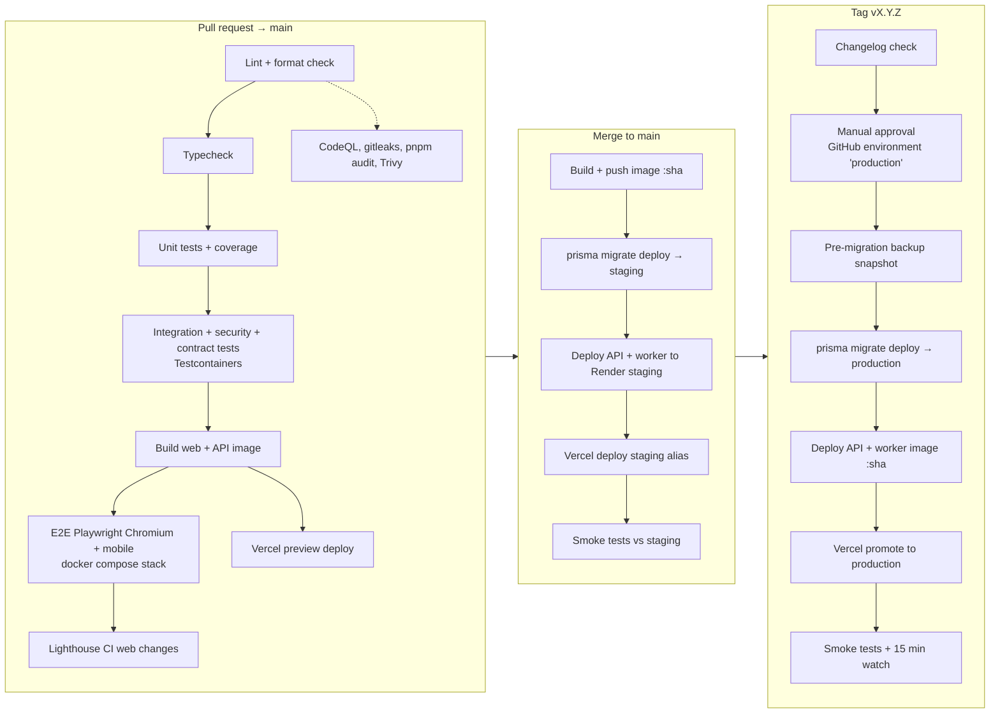

# LinkedOut — Deployment and Operations

Related: [ARCHITECTURE.md §8](ARCHITECTURE.md#8-deployment-architecture) · [ENV_SETUP.md](ENV_SETUP.md) · [SECURITY.md](SECURITY.md) · [TESTING.md](TESTING.md)

## 1. Hosting overview

| Component | Provider | Service | Production size (MVP) | Est. monthly cost (USD) |
|---|---|---|---|---|
| Web (Next.js) | Vercel | Pro project `linkedout-web`, region `fra1` for functions | Pro plan (1 seat) | 20 |
| API | Render | Web Service (Docker), Frankfurt, 2 instances | Standard (2 GB) ×2 | 50 |
| Worker | Render | Background Worker (same image, `node dist/worker.js`) | Starter → Standard | 7–25 |
| PostgreSQL 17 | Render | Managed PostgreSQL with PITR | Basic-4GB (PITR 7 days) | ~25 |
| Redis-compatible | Render | Key Value (Valkey 8), `noeviction` | Starter (256 MB) → Standard | 10 |
| Object storage | Cloudflare R2 | Buckets `linkedout-media`, `linkedout-exports`, `linkedout-backups` | < 10 GB | ~1 |
| DNS/TLS/WAF/CDN | Cloudflare | Pro zone `linkedout.app` | — | 20 |
| Email | Resend | Pro (EU region), domain `linkedout.app` | 50k emails | 20 |
| Errors | Sentry | Team | — | 0–26 |
| Telemetry | Grafana Cloud | Free tier → Pro | — | 0–19 |
| Uptime | Better Stack | Free tier (3 monitors, status page) | — | 0 |
| **Total** | | | | **≈ 150** (within the PRD §10 budget) |

Staging uses the same topology at the smallest tiers (1 API instance, Starter DB without PITR, Free Key Value).

## 2. Environments

| Setting | Local | Staging | Production |
|---|---|---|---|
| Web URL | `http://localhost:3000` | `https://staging.linkedout.app` | `https://linkedout.app` |
| API URL | `http://localhost:4000` | `https://api.staging.linkedout.app` | `https://api.linkedout.app` |
| Media URL | MinIO | `https://files.staging.linkedout.app` | `https://files.linkedout.app` |
| `APP_ENV` | `local` | `staging` | `production` |
| `COOKIE_DOMAIN` | `localhost` | `.staging.linkedout.app` | `.linkedout.app` |
| Database | Docker Postgres | Render Postgres (staging) | Render Postgres (prod, PITR) |
| Data | Seed fixtures | Seed fixtures + anonymized load data; **never production data** | Real |
| Email | Mailpit | Resend with a recipient allow-list (team + beta testers) | Resend |
| Swagger | On | On (behind basic auth at Cloudflare Access) | Off |
| Bull Board | On | On (admin session + Cloudflare Access) | Off |
| Feature flags | All on | Mirrors next production release | Per launch gates |
| Rate limits | On (tests can disable) | On | On |
| Sentry / OTel | Off | On | On |
| Access | Developer | Team via Cloudflare Access (web) during closed phases | Public (invite-only during beta) |
| Vercel previews | — | Per PR, pointing to staging API, `noindex` | — |

## 3. Build steps

### 3.1 Web
1. `pnpm install --frozen-lockfile`
2. `pnpm --filter @linkedout/ui-tokens build` (emits tokens CSS)
3. `pnpm --filter web build` → `next build` (Vercel runs this with Turborepo remote cache)
4. Environment variables per Vercel environment: `NEXT_PUBLIC_API_URL`, `NEXT_PUBLIC_SENTRY_DSN`, `SENTRY_AUTH_TOKEN` (source map upload), `APP_ENV`.

### 3.2 API and worker image (`infra/docker/api.Dockerfile`)
1. **deps stage:** `node:24-bookworm-slim`, corepack pnpm, `pnpm fetch` with the lockfile.
2. **build stage:** `pnpm install --offline --frozen-lockfile`, `pnpm --filter api... build`, `pnpm --filter api exec prisma generate` (both clients), then `pnpm deploy --filter api --prod /out`.
3. **runtime stage:** `gcr.io/distroless/nodejs24-debian12` (non-root `nonroot` user), copy `/out` and the Prisma engines, `ENV NODE_ENV=production`, healthcheck via `/api/v1/health/live`.
4. Default `CMD ["dist/main.js"]`; the worker service overrides it with `dist/worker.js`.
5. The image is tagged `ghcr.io/linkedout-app/linkedout-api:<git-sha>` and `:<version>` on releases. Trivy scans it before push, and the build fails on critical/high fixable CVEs.

## 4. CI/CD pipeline

### 4.1 Workflows

| Workflow | Trigger | Jobs | Required to merge |
|---|---|---|---|
| `ci.yml` | `pull_request`, `push` to `main` | `lint`, `typecheck`, `unit`, `integration` (incl. `test:sec`, contract), `build`, `e2e`, `lighthouse` (web paths only) | Yes, all except `lighthouse` which is required for web changes |
| `security.yml` | PR + nightly 02:00 UTC | CodeQL (JS/TS), gitleaks, `pnpm audit --prod --audit-level high`, Trivy (image), ZAP baseline vs staging (nightly) | CodeQL, gitleaks, audit: yes |
| `deploy-staging.yml` | Push to `main` | Build/push image, migrate staging, Render deploy (API, worker) via deploy hooks with the image SHA, Vercel staging deploy, smoke tests | — |
| `deploy-production.yml` | Tag `v*.*.*` | Verify the tag is on `main` and CI is green, verify the CHANGELOG entry, manual approval (2 reviewers listed in environment protection), Render snapshot, migrate production, deploy, Vercel promote, smoke tests, Sentry release + deploy markers | — |
| `load-test.yml` | Manual (`workflow_dispatch`) | k6 scripts vs staging with thresholds; uploads a summary | — |

### 4.2 Branch protection (`main`)
- PR required, with 1 approving review (2 for changes under `apps/api/src/modules/vault`, `identity`, `moderation`, `prisma/migrations` via CODEOWNERS).
- Required status checks listed above; branch up to date before merge; linear history (squash merge).
- No force pushes; signed commits recommended.

### 4.3 Smoke tests (post-deploy)
1. `GET /api/v1/health/ready` → 200 with all checks ok.
2. `GET /api/v1/categories` → 12 active categories.
3. `GET /api/v1/feed?limit=1` → 200.
4. Web `/` and `/mess` → 200, and the HTML contains the expected landmark.
5. Staging only: a scripted register → Mailpit/Resend test inbox verification → login → create post → delete post.

## 5. Database migrations in deployment

1. Migrations run **before** the new code deploys, as `lo_migrator` from CI (the `MIGRATION_DATABASE_URL` secret exists only in the GitHub environment).
2. Migrations must be **backward-compatible with the previous release** (expand/contract):
   - Add a nullable column or a new table, deploy code that writes both, backfill in a job, then make it required in a later release.
   - Never rename or drop in the same release as the code change.
3. Long index builds use `CREATE INDEX CONCURRENTLY` in a separate migration marked non-transactional.
4. A Render on-demand snapshot is taken before each production migration (retained 7 days).
5. If a migration fails, the deploy stops. The DB stays on the previous schema and the previous code keeps running.

## 6. Domains, DNS and TLS

| Record | Type | Target | Proxy |
|---|---|---|---|
| `linkedout.app` | CNAME (flattened) | `cname.vercel-dns.com` | DNS only (Vercel manages TLS) |
| `www.linkedout.app` | CNAME | `cname.vercel-dns.com` (redirects to apex) | DNS only |
| `staging.linkedout.app` | CNAME | `cname.vercel-dns.com` | DNS only |
| `api.linkedout.app` | CNAME | `linkedout-api.onrender.com` | Proxied (WAF, rate rules) |
| `api.staging.linkedout.app` | CNAME | `linkedout-api-staging.onrender.com` | Proxied |
| `files.linkedout.app` | R2 custom domain | `linkedout-media` bucket | Proxied |
| Email | TXT/CNAME | Resend SPF, DKIM (2 keys), DMARC `p=quarantine; rua=mailto:dmarc@linkedout.app` | — |
| CAA | CAA | `letsencrypt.org`, `pki.goog`, `digicert.com` (Cloudflare/Vercel issuers) | — |

TLS: Cloudflare "Full (strict)" mode to Render, with edge certificates by Cloudflare. Vercel issues certificates for the web domains. HSTS preload is submitted after 30 days of stable HTTPS. The minimum TLS version is 1.2.

## 7. Monitoring, logging and alerting

### 7.1 Telemetry

| Signal | Source | Destination | Retention |
|---|---|---|---|
| Traces | OpenTelemetry auto-instrumentation (HTTP, Express, Prisma, ioredis, BullMQ spans) | Grafana Tempo | 14 days |
| Metrics | OTel metrics: request rate/latency/status per route, queue depth & age, job durations, DB pool usage, custom (`moderation_open_items`, `moderation_high_priority_age_minutes`, `safety_holds_total`, `vault_access_total`) | Grafana Mimir | 13 months |
| Logs | pino JSON to stdout → Render log stream → Grafana Loki (and Vercel log drain for web) | Loki | 30 days |
| Errors | Sentry (API, worker, web), release-tagged with source maps | Sentry | 90 days |
| Uptime | Better Stack checks every 1 min: `linkedout.app`, `api.linkedout.app/api/v1/health/ready`, `files.linkedout.app/health.txt` | Status page `status.linkedout.app` | 1 year |

Log format fields: `time`, `level`, `msg`, `requestId`, `route`, `statusCode`, `durationMs`, `module`, `env`, `version`. Redaction is described in ARCHITECTURE §4.4. User IDs appear only in modules allowed to log them (identity, admin) and never with anonymous content IDs.

### 7.2 Dashboards
1. **API health:** RPS, p50/p95/p99 latency per route group, 4xx/5xx rate, instance CPU/memory.
2. **Queues:** depth and oldest-job age per queue, failure rate, email send rate.
3. **Trust & safety:** open moderation items by priority, median time to first action (high/normal), held items age, reports per 1,000 posts, appeals pending, vault accesses.
4. **Product (admin):** sign-ups, verifications, posts/day (also shown in S-30).

### 7.3 Alerts (Grafana → email + Discord/Slack channel `#linkedout-alerts`; paging via phone for P1)

| Alert | Condition | Severity |
|---|---|---|
| API down | Uptime check fails 2 consecutive minutes | P1 |
| High error rate | 5xx > 2% over 5 min | P1 |
| Latency | p95 > 800 ms over 10 min | P2 |
| DB connections | Pool usage > 85% for 5 min | P2 |
| Redis memory | > 80% | P2 |
| Queue stalled | Oldest job in `email` or `notifications` > 10 min, or depth > 500 | P2 |
| Deletion job failure | `account-deletion` job failed after retries | P2 |
| Moderation SLA | High-priority item older than 4 h | P2 (T&S lead) |
| Moderation backlog | Open items > 100 | P3 |
| Vault denied | Any `vault.reveal_denied` audit event | P2 (security) |
| Vault reveal | Any approved reveal (informational to both founders) | P3 |
| Auth anomaly | Failed logins > 200/min or registrations > 50/min | P2 |
| Certificate expiry | < 14 days | P3 |
| Backup failure | Daily logical backup job failed | P2 |

## 8. Backups and restore

| Backup | Mechanism | Frequency | Retention | Location |
|---|---|---|---|---|
| Point-in-time recovery | Render PostgreSQL PITR (WAL) | Continuous | 7 days | Render |
| Logical backup | GitHub Actions scheduled job: `pg_dump -Fc` as `lo_migrator`, encrypted with `age` (public key) | Daily 03:00 UTC | 30 daily, 12 monthly | R2 `linkedout-backups` (separate account token, object lock) |
| Pre-migration snapshot | Render snapshot via API | Every production migration | 7 days | Render |
| Object storage | R2 media is reproducible from uploads only; exports are ephemeral | — | — | Media bucket has versioning enabled (30 days) |
| Configuration | `render.yaml`, Vercel project config, Cloudflare settings exported monthly | Monthly | 12 months | Git (no secrets) |

**Monthly restore test** (`scripts/restore-test.sh`, owner: DevOps support):
1. Download the latest logical backup and decrypt it with the offline private key (held by two founders).
2. Restore into a fresh staging database `linkedout_restore_test`.
3. Run `prisma migrate status` (expect up to date) and the integrity queries: row counts within 1% of the production metrics snapshot, the FK check, the vault row count equal to the anonymous content count.
4. Re-apply completed account deletions newer than the backup from the `account_deletion_requests` log.
5. Record the duration (RTO evidence) and the result in `docs/runbooks/restore-log.md`, then drop the database.

## 9. Release and rollback

### 9.1 Versioning and release
- SemVer tags `vMAJOR.MINOR.PATCH`. MVP launch = `v1.0.0`; Should-have release = `v1.1.0`.
- `docs/CHANGELOG.md` must have the version entry before tagging (enforced by the workflow).
- Feature flags decouple deploys from launches (`confessions.enabled`, `communities.enabled`, `registration.open`, `beta.invite_only`).

### 9.2 Rollback procedure

| Situation | Action | Time |
|---|---|---|
| Bad API/worker deploy, no schema change | Render dashboard or API: "Rollback" to the previous deploy (previous image SHA) | < 5 min |
| Bad web deploy | Vercel "Promote previous deployment" / instant rollback | < 2 min |
| Feature misbehaving | Turn its feature flag off in S-31 (audit-logged) | < 1 min |
| Migration applied, code incompatible | Expand/contract rules mean the previous code still works: roll back the code only. Never auto-run down migrations. | < 5 min |
| Data corruption | Declare an incident; stop writes (`registration.open=false` + maintenance mode env `MAINTENANCE_MODE=true` → API returns 503 for writes); restore via PITR to a new instance at a timestamp before the corruption; verify; switch `DATABASE_URL`/`VAULT_DATABASE_URL`; re-enable | 1–4 h (RTO ≤ 4 h) |

After every rollback: open an incident issue, write a post-incident review within 5 business days, and add a regression test.

## 10. Launch-day checklist (production)

1. Security review complete and pentest findings fixed (SECURITY §15).
2. Backup restore tested within the last 30 days.
3. Policies published: Terms, Privacy Policy, Community Guidelines, transparency report plan.
4. Support (`support@`), privacy (`privacy@`), legal (`legal@`) and security (`security@`) mailboxes monitored; `security.txt` live.
5. Monitoring dashboards and alerts verified with test alerts.
6. Moderator rota staffed for the first 14 days (coverage 08:00–24:00 IST/CET with on-call for P1 safety).
7. Legal request process documented and counsel contact confirmed.
8. Feature flags: `beta.invite_only=false`, `registration.open=true`, `confessions.enabled=true` (launch gate confirmed), `communities.enabled=false` until v1.1.

## 11. Operational runbooks

Each runbook lives in `docs/runbooks/<name>.md` (created in TASKS Phase 7) and follows the same structure: detection → triage → mitigation → communication → recovery → post-incident review.

| Runbook | Trigger | Key steps |
|---|---|---|
| `service-outage.md` | API/web down alert | Check status pages (Render, Vercel, Cloudflare); check the last deploy → roll back; check DB/Redis health; post on the status page within 15 min; updates every 30 min. |
| `data-breach.md` | Suspected unauthorized data access | Contain (rotate credentials, revoke sessions, block IPs at Cloudflare); preserve logs; assess the scope; notify the supervisory authority within 72 h if personal data is affected; notify affected members; engage counsel. |
| `account-takeover.md` | Member reports unauthorized access / auth anomaly alert | Revoke all sessions, force a password reset, review audit logs, check for content changes, restore if needed, contact the member via verified email. |
| `malicious-content.md` | Threats, doxxing, illegal content spike | Remove/limit via moderation; escalate credible threats via the reveal workflow and contact authorities where legally required; preserve evidence under legal hold; check for coordinated activity. |
| `anonymous-identity-exposure.md` | Any suspicion that an anonymous author was exposed (bug, leak, staff misuse) | Treat as P1: disable the affected endpoint/flag, identify affected aliases, notify affected members, fix with a regression test (SEC-05), review vault audit logs, report in the transparency report. |
| `database-recovery.md` | Corruption, accidental deletion | Maintenance mode, PITR restore to a new instance, verify, switch connection strings, re-apply deletions, post-incident review. |
| `moderation-backlog.md` | Backlog alert / SLA breach | Enable `beta.invite_only` or rate-limit new accounts more strictly, recruit extra moderators from the rota, prioritize high items, temporarily auto-limit (not remove) new medium-risk confessions, communicate expected delays in UI copy. |
| `legal-privacy-request.md` | Legal order, data subject request | Follow SECURITY §10 / §9.4; log the request; meet deadlines (30 days for data subject requests). |
| `secret-rotation.md` | Scheduled or suspected exposure | Rotation order per secret, dual-key windows (`VAULT_ENCRYPTION_KEY_ID`), verification steps. |
| `restore-test.md` | Monthly | Steps in §8. |
