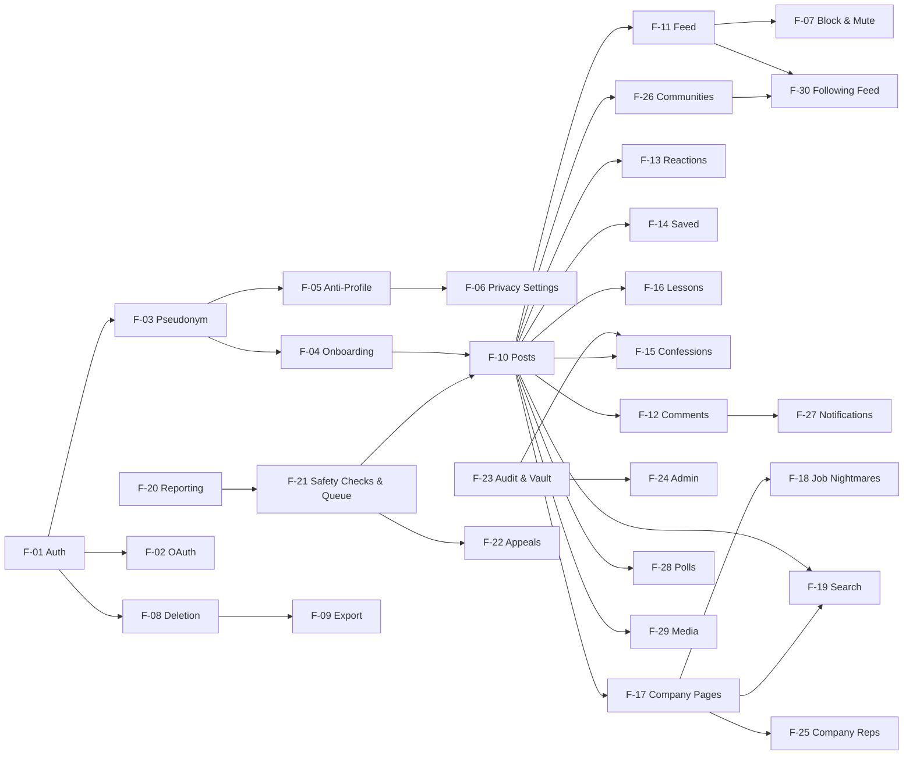

# LinkedOut — Feature Catalogue

Every feature has a stable ID (F-01 … F-43) used across [PRD.md](PRD.md), [USER_STORIES.md](USER_STORIES.md), [API_SPEC.md](API_SPEC.md), [DATABASE_SCHEMA.md](DATABASE_SCHEMA.md), [UI_UX.md](UI_UX.md) and [TASKS.md](TASKS.md).

**Priority:** **MVP** = first public release (week 16) · **Should** = v1.1, soon after launch · **Future** = later releases.

## Summary matrix

| ID | Feature | Plan concept | Priority | Backend module | Stories | Requirements |
|---|---|---|---|---|---|---|
| F-01 | Accounts & Authentication | §6.1 | MVP | identity | US-005–US-009 | FR-1–FR-6 |
| F-02 | OAuth Sign-in (Google) | §6.1 | Should | identity | US-010 | FR-7 |
| F-03 | Public Pseudonym & Identity Separation | §6.1, §14 | MVP | identity, profile | US-011, US-012, US-069 | FR-8–FR-10 |
| F-04 | Onboarding & Privacy Explanation | §9 screen 3 | MVP | identity | US-013 | FR-11 |
| F-05 | Anti-Profile | §6.2 | MVP | profile | US-014–US-016 | FR-12–FR-14 |
| F-06 | Privacy Settings | §6.1 | MVP | profile | US-017 | FR-15 |
| F-07 | Block & Mute | §6.1, §14 | MVP | safety | US-018, US-019, US-027 | FR-16, FR-17 |
| F-08 | Account Deletion | §6.1 | MVP | identity | US-020 | FR-18 |
| F-09 | Data Export | §6.1, §17 | Should | identity | US-021 | FR-19 |
| F-10 | Posts, Categories, Tags & Content Warnings | §6.3 | MVP | content | US-002, US-022–US-025 | FR-20–FR-23 |
| F-11 | The Mess — Latest Feed & Filters | §6.3, §13 | MVP | feed | US-001, US-026, US-027 | FR-24, FR-25 |
| F-12 | Comments | §6.4 | MVP | engagement | US-002, US-028–US-030 | FR-26–FR-28 |
| F-13 | Reactions | §6.4 | MVP | engagement | US-031 | FR-29 |
| F-14 | Saved Posts | §6.2, §18 | MVP | engagement | US-032 | FR-30 |
| F-15 | Office Confessions | §6.5 | MVP | confession | US-033–US-036 | FR-31–FR-34 |
| F-16 | Learned the Hard Way | §6.10 | MVP | content | US-037, US-038 | FR-35 |
| F-17 | Workplace Reality Pages | §6.6 | MVP | company | US-003, US-039–US-041 | FR-36–FR-40 |
| F-18 | Job Nightmare Board | §6.7 | MVP | jobreport | US-042, US-043 | FR-41, FR-42 |
| F-19 | Search | §17 | MVP | search | US-004, US-044 | FR-43 |
| F-20 | Content Reporting | §14, §15 | MVP | moderation | US-045, US-046 | FR-44 |
| F-21 | Automated Safety Checks & Moderation Queue | §6.5, §15 | MVP | moderation, safety | US-034, US-060–US-062, US-064, US-065 | FR-45–FR-48 |
| F-22 | Appeals | §15 | MVP | moderation | US-047, US-063 | FR-49 |
| F-23 | Audit Logging & Identity Vault | §7, §14 | MVP | audit, vault | US-066, US-075 | FR-50, FR-51 |
| F-24 | Admin Dashboard (basic) | §17 | MVP | admin | US-070–US-072, US-074 | FR-52–FR-55 |
| F-25 | Company Representative Verification & Responses | §6.6, §8 D | Should | company | US-067–US-069, US-073 | FR-56–FR-58 |
| F-26 | Communities (Trauma Network) | §6.8 | Should | community | US-048–US-051, US-058, US-059 | FR-59–FR-63 |
| F-27 | Notifications (in-app & email) | §6.11 | Should | notification | US-052, US-053 | FR-64–FR-66 |
| F-28 | Polls | §6.3 | Should | content | US-054, US-055 | FR-67 |
| F-29 | Image & Meme Posts (media upload) | §6.3 | Should | media | US-056 | FR-68 |
| F-30 | Topic Following & Following Feed | §6.3, §13 | Should | feed | US-057 | FR-69, FR-70 |
| F-31 | Direct Messaging | §6.9 | Future | messaging | US-076 | FR-71 |
| F-32 | Career Damage Report | §6.13 | Future | analytics | US-077 | FR-72 |
| F-33 | Corporate Meme Generator | §6.12 | Future | media | US-078 | FR-73 |
| F-34 | Hall of Shame | §6.12 | Future | content | US-079 | FR-74 |
| F-35 | Relevant Feed Ranking | §13 | Future | feed | US-080 | FR-75 |
| F-36 | AI-assisted Categorization | §17 | Future | safety | US-084 | FR-76 |
| F-37 | Premium Membership | §16 | Future | billing | US-082 | FR-77 |
| F-38 | Employer Analytics & Trend Reports | §16 | Future | analytics | US-083 | FR-78 |
| F-39 | Multi-factor Authentication | §14 | Future | identity | US-081 | FR-79 |
| F-40 | Mobile Applications | §17 | Future | — (clients) | US-085 | FR-80 |
| F-41 | Learning Paths | §6.10 | Future | content | US-086 | FR-81 |
| F-42 | Push Notifications | §6.11 | Future | notification | US-087 | FR-82 |
| F-43 | Survivor Events & Meetups | §5 | Future | community | US-088 | FR-83 |

## Dependency graph (MVP + Should)

---

## MVP features

### F-01 — Accounts & Authentication
| Attribute | Value |
|---|---|
| Description | Email + password registration with breached-password check, email verification, login/logout with Redis-backed server sessions, password reset, session/device list and revocation, brute-force lockout. |
| Priority | MVP |
| Roles | Visitor (register, log in), Member (sessions, logout) |
| User stories | US-005, US-006, US-007, US-008, US-009 |
| Requirements | FR-1, FR-2, FR-3, FR-4, FR-5, FR-6 |
| Dependencies | Email delivery (Resend / Mailpit), Redis, `users`, `sessions`, `auth_tokens` tables |
| API | `/auth/*`, `/me/sessions` |
| Screens | S-02 Sign up, S-03 Log in, S-04 Verify email, S-05 Forgot/Reset password, S-27 Settings → Sessions |

### F-03 — Public Pseudonym & Identity Separation
| Attribute | Value |
|---|---|
| Description | Every member has a unique public username that is never derived from their email or name. Private account data (`users`) is physically separate from the public profile (`profiles`). Response serializers whitelist public fields, and contract tests enforce FR-10. Username change rules limit pseudonym churn. |
| Priority | MVP |
| Roles | Member, all API consumers |
| User stories | US-011, US-012, US-069 |
| Requirements | FR-8, FR-9, FR-10 |
| Dependencies | F-01 |
| API | `GET /auth/username-availability`, `PATCH /me/username`, all public DTOs |
| Screens | S-02, S-25 Settings → Profile |

### F-04 — Onboarding & Privacy Explanation
| Attribute | Value |
|---|---|
| Description | 4-step onboarding after verification: pseudonym vs anonymous, data collected and why, lawful disclosure, Community Guidelines acknowledgement, then interest selection. Required before first publish. |
| Priority | MVP |
| Roles | Member |
| User stories | US-013 |
| Requirements | FR-11 |
| Dependencies | F-01, F-03 |
| API | `POST /me/onboarding/complete`, `GET /categories` |
| Screens | S-06 Onboarding |

### F-05 — Anti-Profile
| Attribute | Value |
|---|---|
| Description | Public profile reflecting real career experience: username, headline, bio, industry, broad location, career status (including "Open to Escape"), career lessons, skills being learned, optional experience timeline, and pseudonymous posts and comments. It has no hardship counts, rankings or reaction totals. |
| Priority | MVP |
| Roles | Member (edit), Visitor/Member (view per visibility) |
| User stories | US-014, US-015, US-016 |
| Requirements | FR-12, FR-13, FR-14 |
| Dependencies | F-03; avatar upload depends on F-29 (Should) — until then a generated monogram avatar is used |
| API | `GET /profiles/:username`, `GET /profiles/:username/posts`, `GET /profiles/:username/comments`, `PATCH /me/profile`, `PUT /me/profile/lessons`, `PUT /me/profile/skills`, `PUT /me/profile/timeline` |
| Screens | S-12 Public Anti-Profile, S-25 Settings → Profile |

### F-06 — Privacy Settings
| Attribute | Value |
|---|---|
| Description | Profile visibility (`public`/`members`/`hidden`), discoverability in member search, default confession identity mode, default post visibility; stored message permissions for F-31. |
| Priority | MVP |
| Roles | Member |
| User stories | US-017 |
| Requirements | FR-15 |
| Dependencies | F-05 |
| API | `GET /me/privacy`, `PATCH /me/privacy` |
| Screens | S-26 Settings → Privacy |

### F-07 — Block & Mute
| Attribute | Value |
|---|---|
| Description | Block members or anonymous labels (two-way interaction barrier; blocker stops seeing content); mute members, categories, tags (one-way feed/search filter). Hidden-category feed control is implemented as a category mute. Anonymous-label blocks never reveal the underlying account. |
| Priority | MVP |
| Roles | Member |
| User stories | US-018, US-019, US-027 |
| Requirements | FR-16, FR-17 |
| Dependencies | F-11, F-12, F-15 |
| API | `GET/POST /me/blocks`, `DELETE /me/blocks/:blockId`, `GET/POST /me/mutes`, `DELETE /me/mutes/:muteId` |
| Screens | S-28 Settings → Blocked & muted; content overflow menus |

### F-08 — Account Deletion
| Attribute | Value |
|---|---|
| Description | Self-service deletion request with re-authentication, retention explanation, 30-day grace period with cancellation, then automated purge/anonymization job. |
| Priority | MVP |
| Roles | Member |
| User stories | US-020 |
| Requirements | FR-18 |
| Dependencies | F-01, background worker (`account-deletion` queue) |
| API | `DELETE /me/account`, `POST /me/account/cancel-deletion` |
| Screens | S-29 Settings → Account & data |

### F-10 — Posts, Categories, Tags & Content Warnings
| Attribute | Value |
|---|---|
| Description | Create, edit and delete `story` and `advice` posts (text, Markdown subset, long-form "Read more" > 3,000 chars) with one of 12 categories, up to 5 tags, desired response, language, visibility and content warnings; revisions stored; corrections supported (shared with F-15). |
| Priority | MVP |
| Roles | Member (create/edit own), Visitor (read public) |
| User stories | US-002, US-022, US-023, US-024, US-025 |
| Requirements | FR-20, FR-21, FR-22, FR-23 |
| Dependencies | F-04, F-21 (safety check) |
| API | `POST /posts`, `GET/PATCH/DELETE /posts/:postId`, `POST /posts/:postId/corrections`, `GET /categories`, `GET /tags`, `POST /safety/check` |
| Screens | S-08 Create post, S-11 Post detail |

### F-11 — The Mess — Latest Feed & Filters
| Attribute | Value |
|---|---|
| Description | Reverse-chronological cursor-paginated feed with filters (category, post type, language), hidden categories, exclusion of blocked/muted/held/removed content; visitor first-page cache. |
| Priority | MVP |
| Roles | Visitor, Member |
| User stories | US-001, US-026, US-027 |
| Requirements | FR-24, FR-25 |
| Dependencies | F-10, F-07 |
| API | `GET /feed` |
| Screens | S-07 The Mess |

### F-12 — Comments
| Attribute | Value |
|---|---|
| Description | Threaded comments and replies (rendered depth ≤ 3), edit/delete own, "[deleted]" placeholders, pinned author clarification, rate limits, report/block from menu; OP badge for anonymous confession authors replying under their label. |
| Priority | MVP |
| Roles | Member (write), Visitor (read) |
| User stories | US-002, US-028, US-029, US-030 |
| Requirements | FR-26, FR-27, FR-28 |
| Dependencies | F-10, F-21 |
| API | `GET/POST /posts/:postId/comments`, `PATCH/DELETE /comments/:commentId`, `PUT/DELETE /posts/:postId/pinned-comment` |
| Screens | S-11 Post detail |

### F-13 — Reactions
| Attribute | Value |
|---|---|
| Description | One reaction per member per post from: I'm Dead (`im_dead`), Pain (`pain`), Same Here (`same_here`), Melting (`melting`), Corporate Circus (`corporate_circus`), Survived (`survived`). Change/remove supported; per-type counts on the post only. |
| Priority | MVP |
| Roles | Member |
| User stories | US-031 |
| Requirements | FR-29 |
| Dependencies | F-10 |
| API | `POST /posts/:postId/reactions`, `DELETE /posts/:postId/reactions` |
| Screens | S-07, S-11 (ReactionBar component) |

### F-14 — Saved Posts
| Attribute | Value |
|---|---|
| Description | Private bookmarking of posts (including lessons and confessions), listed in My Damage → Saved. |
| Priority | MVP |
| Roles | Member |
| User stories | US-032 |
| Requirements | FR-30 |
| Dependencies | F-10 |
| API | `PUT/DELETE /posts/:postId/save`, `GET /me/saved` |
| Screens | S-13 My Damage (Saved tab) |

### F-15 — Office Confessions
| Attribute | Value |
|---|---|
| Description | Structured confession submission with three identity modes: public pseudonym, anonymous to members (per-confession generated label stored only in the Identity Vault), private draft. Three-step write → safety check & preview → confirm flow; corrections; OP badge; stricter hold rules. Feature-flagged `confessions.enabled` until F-20, F-21, F-22 and F-23 are complete in production. |
| Priority | MVP |
| Roles | Member |
| User stories | US-033, US-034, US-035, US-036 |
| Requirements | FR-31, FR-32, FR-33, FR-34 |
| Dependencies | F-10, F-21, F-23 |
| API | `POST /confessions`, `GET /confessions`, `GET/PATCH/DELETE /confessions/:confessionId`, `POST /posts/:postId/corrections` |
| Screens | S-09 Confession submission, S-10 Confessions list, S-11 Post detail |

### F-16 — Learned the Hard Way
| Attribute | Value |
|---|---|
| Description | `lesson` post type with structured sections (what I did wrong, what happened, what I learned, what I'd do differently, advice, up to 5 links) and a dedicated listing filtered by category. |
| Priority | MVP |
| Roles | Member (write), Visitor (read public) |
| User stories | US-037, US-038 |
| Requirements | FR-35 |
| Dependencies | F-10 |
| API | `POST /posts` (`postType: "lesson"`), `GET /lessons` |
| Screens | S-08 Create post (Lesson mode), S-14 Learned the Hard Way |

### F-17 — Workplace Reality Pages
| Attribute | Value |
|---|---|
| Description | Company directory, company submission with duplicate detection, Workplace Reality Pages with structured workplace reviews (relationship, period, 5 topic ratings, narrative, firsthand attestation, display consent), "Unverified firsthand account" labels, minimum-sample theme summaries (n ≥ 5 in 24 months), filters, report/correction controls. |
| Priority | MVP |
| Roles | Visitor (read), Member (review, submit company), Administrator (approve) |
| User stories | US-003, US-039, US-040, US-041 |
| Requirements | FR-36, FR-37, FR-38, FR-39, FR-40 |
| Dependencies | F-10 (shared safety pipeline), F-21, F-24 (approval) |
| API | `GET/POST /companies`, `GET /companies/:companyIdOrSlug`, `GET/POST /companies/:companyId/reviews`, `PATCH/DELETE /reviews/:reviewId` |
| Screens | S-15 Company directory, S-16 Workplace Reality Page, S-17 Write review, S-18 Submit company |

### F-18 — Job Nightmare Board
| Attribute | Value |
|---|---|
| Description | Recruitment experience reports with 8 types (misleading job description, unclear salary or benefits, interview process problems, candidate ghosting, unpaid test assignment, unexpected work requirements, offer changed or withdrawn, positive or respectful hiring experience), stage reached, outcome, identity mode, visibility; board listing and company page integration; interview-question-dump detection. |
| Priority | MVP |
| Roles | Member (write), Visitor (read public) |
| User stories | US-042, US-043 |
| Requirements | FR-41, FR-42 |
| Dependencies | F-17, F-21, F-23 (anonymous mode) |
| API | `POST/GET /job-reports`, `GET/PATCH/DELETE /job-reports/:jobReportId` |
| Screens | S-19 Job Nightmare Board, S-20 Job Nightmare report form |

### F-19 — Search
| Attribute | Value |
|---|---|
| Description | PostgreSQL full-text search (`tsvector` + GIN) over posts, lessons, confessions and job reports; trigram search on companies; member search (discoverable only); communities after F-26. Respects visibility, moderation, blocks, mutes. |
| Priority | MVP |
| Roles | Visitor, Member |
| User stories | US-004, US-044 |
| Requirements | FR-43 |
| Dependencies | F-10, F-17, F-18 |
| API | `GET /search` |
| Screens | S-21 Search results |

### F-20 — Content Reporting
| Attribute | Value |
|---|---|
| Description | Report any user-generated target with one of 9 reasons and details; de-duplicate per reporter; aggregate into moderation items; "My reports" status tracking with outcome emails. |
| Priority | MVP |
| Roles | Member |
| User stories | US-045, US-046 |
| Requirements | FR-44 |
| Dependencies | F-21 |
| API | `POST /reports`, `GET /me/reports` |
| Screens | ReportDialog component, S-22 Report & appeal center |

### F-21 — Automated Safety Checks & Moderation Queue
| Attribute | Value |
|---|---|
| Description | Pre-publish `SafetyCheckService` (PII, secrets, named individuals, threats, interview-question dumps, new-account velocity) producing risk levels; holds; unified prioritized moderation queue with claim/assign; 8 proportionate moderator actions with mandatory reasons and notifications; coordinated review campaign detection; escalation. |
| Priority | MVP |
| Roles | Member (subject to checks), Platform moderator |
| User stories | US-034, US-060, US-061, US-062, US-064, US-065 |
| Requirements | FR-45, FR-46, FR-47, FR-48 |
| Dependencies | F-23 (audit), email |
| API | `POST /safety/check`, `GET /moderation/queue`, `GET /moderation/items/:itemId`, `POST /moderation/items/:itemId/claim`, `POST /moderation/items/:itemId/actions` |
| Screens | S-23 Moderator dashboard, S-24 Moderation item detail |

### F-22 — Appeals
| Attribute | Value |
|---|---|
| Description | One appeal per moderation action within 30 days; decided by a different moderator; outcomes upheld/reversed/modified with automatic reversal and notification. |
| Priority | MVP |
| Roles | Member (appeal), Platform moderator (decide) |
| User stories | US-047, US-063 |
| Requirements | FR-49 |
| Dependencies | F-21 |
| API | `GET /me/moderation-actions`, `POST /moderation/actions/:actionId/appeal`, `GET /moderation/appeals`, `POST /moderation/appeals/:appealId/decision` |
| Screens | S-22 Report & appeal center, S-23 Moderator dashboard (Appeals tab) |

### F-23 — Audit Logging & Identity Vault
| Attribute | Value |
|---|---|
| Description | Append-only `audit_logs`; `vault` PostgreSQL schema holding anonymous alias mappings, accessible only via `IdentityVaultService` using a dedicated DB role; four-eyes identity reveal workflow with justification and 24 h access window. |
| Priority | MVP |
| Roles | Platform moderator with `identity_vault.reveal`, Administrator (audit read) |
| User stories | US-066, US-075 |
| Requirements | FR-50, FR-51 |
| Dependencies | F-01 |
| API | `POST /trust-safety/identity-reveals`, `POST /trust-safety/identity-reveals/:revealId/approve`, `GET /trust-safety/identity-reveals/:revealId`, `GET /admin/audit-logs` |
| Screens | S-24 Moderation item (Reveal panel), S-31 Admin → Audit log |

### F-24 — Admin Dashboard (basic)
| Attribute | Value |
|---|---|
| Description | User search, role and permission management, category management, company approval/merge/suspend, platform metrics, escalations view. |
| Priority | MVP |
| Roles | Administrator |
| User stories | US-070, US-071, US-072, US-074 |
| Requirements | FR-52, FR-53, FR-54, FR-55 |
| Dependencies | F-23 |
| API | `/admin/*` |
| Screens | S-30 Admin dashboard, S-31 Admin sub-pages |

---

## Should-have features (v1.1)

### F-02 — OAuth Sign-in (Google)
| Attribute | Value |
|---|---|
| Description | Google OpenID Connect sign-in/sign-up with PKCE and `state`; account linking for matching emails after password confirmation; no profile data imported. |
| Priority | Should |
| Roles | Visitor, Member |
| User stories | US-010 |
| Requirements | FR-7 |
| Dependencies | F-01 |
| API | `GET /auth/oauth/google`, `GET /auth/oauth/google/callback`, `POST /auth/oauth/complete-signup` |
| Screens | S-02, S-03 (Google button) |

### F-09 — Data Export
| Attribute | Value |
|---|---|
| Description | Asynchronous ZIP/JSON export of all of a member's data delivered by expiring signed link. |
| Priority | Should |
| Roles | Member |
| User stories | US-021 |
| Requirements | FR-19 |
| Dependencies | F-08 (shared data inventory), object storage, `data-export` queue |
| API | `POST /me/exports`, `GET /me/exports/:exportId` |
| Screens | S-29 Settings → Account & data |

### F-25 — Company Representative Verification & Responses
| Attribute | Value |
|---|---|
| Description | Representatives verify a work email on the company's confirmed domain; admin approval; 12-month memberships; one official response per review/job report; no removal powers; no identity access. |
| Priority | Should |
| Roles | Company representative, Administrator |
| User stories | US-067, US-068, US-069, US-073 |
| Requirements | FR-56, FR-57, FR-58 |
| Dependencies | F-17, F-21, F-24 |
| API | `POST /companies/:companyId/representation-requests`, `POST /companies/representation-requests/verify-email`, `GET /me/company-memberships`, `POST /companies/:companyId/responses`, `PATCH /company-responses/:responseId`, `GET /admin/company-memberships`, `POST /admin/company-memberships/:membershipId/decision` |
| Screens | S-16 (Response area), S-32 Representative request |

### F-26 — Communities (Trauma Network)
| Attribute | Value |
|---|---|
| Description | Create/discover communities, join/leave, private communities with join requests, community feed, rules, up to 5 pinned resources, community moderators with scoped queue. Seeded examples: Fresh Graduate Survivors, Failed Startup Survivors, Developer Debugging Support, Interview Rejection Society, Career Changers, Workplace Boundaries, Monday Survivors. |
| Priority | Should |
| Roles | Member, Community moderator |
| User stories | US-048, US-049, US-050, US-051, US-058, US-059 |
| Requirements | FR-59, FR-60, FR-61, FR-62, FR-63 |
| Dependencies | F-10, F-20, F-21 |
| API | `/communities/*` |
| Screens | S-33 Communities directory, S-34 Community page, S-35 Create community |

### F-27 — Notifications (in-app & email)
| Attribute | Value |
|---|---|
| Description | In-app notification center with unread count (polled every 60 s), email notifications via worker, per-type preferences, quiet hours, batching of reactions, daily digest for followed topics, mandatory moderation emails, non-manipulative copy. |
| Priority | Should |
| Roles | Member |
| User stories | US-052, US-053 |
| Requirements | FR-64, FR-65, FR-66 |
| Dependencies | F-12, F-13, F-21, F-26, BullMQ `notifications` and `email` queues |
| API | `GET /notifications`, `GET /notifications/unread-count`, `POST /notifications/:notificationId/read`, `POST /notifications/read-all`, `GET/PATCH /me/notification-preferences` |
| Screens | S-36 Notification center, S-37 Settings → Notifications |

### F-28 — Polls
| Attribute | Value |
|---|---|
| Description | `poll` post type with 2–6 options, 1–14 day duration, one vote per member, results after vote/close, anonymous tallies. |
| Priority | Should |
| Roles | Member |
| User stories | US-054, US-055 |
| Requirements | FR-67 |
| Dependencies | F-10 |
| API | `POST /posts` (`postType: "poll"`), `POST /posts/:postId/poll/votes` |
| Screens | S-08 Create post (Poll mode), PollCard component |

### F-29 — Image & Meme Posts (media upload)
| Attribute | Value |
|---|---|
| Description | Up to 4 images per post and avatars; pre-signed upload to object storage; server-side validation of magic bytes; EXIF strip and re-encode (sharp); ClamAV scan; mandatory alt text; `meme` post type. |
| Priority | Should |
| Roles | Member |
| User stories | US-056 |
| Requirements | FR-68 |
| Dependencies | F-10, object storage, `media-scan` queue |
| API | `POST /media/uploads`, `POST /media/:mediaId/complete`, `GET /media/:mediaId` |
| Screens | S-08 (image picker), S-25 (avatar) |

### F-30 — Topic Following & Following Feed
| Attribute | Value |
|---|---|
| Description | Follow categories and tags; Following feed mode combining followed topics and joined communities. |
| Priority | Should |
| Roles | Member |
| User stories | US-057 |
| Requirements | FR-69, FR-70 |
| Dependencies | F-11, F-26 |
| API | `GET/POST /me/follows`, `DELETE /me/follows/:followId`, `GET /feed?mode=following` |
| Screens | S-07 (Following tab) |

---

## Future features

| ID | Feature | Description | Roles | Stories | FR | Dependencies |
|---|---|---|---|---|---|---|
| F-31 | Direct Messaging | One-to-one peer support conversations; message requests; block/report; no attachments initially; spam controls; safety notices; user-controlled permissions; anonymous confession authors cannot be messaged. Polling-based, not real-time chat. | Member | US-076 | FR-71 | F-07, F-20, F-27 |
| F-32 | Career Damage Report | Private reflective dashboard: applications tracked, interview stages, lessons saved, skills in development, career goals, private notes. No public score, no mental-health inference. | Member | US-077 | FR-72 | F-05, F-14 |
| F-33 | Corporate Meme Generator | Templates, text editing, preview, export, optional sharing with PII/harassment checks. | Member | US-078 | FR-73 | F-29, F-21 |
| F-34 | Hall of Shame | Editorially curated pattern highlights from anonymized moderated stories; never a leaderboard of people. | Member, Platform moderator | US-079 | FR-74 | F-21 |
| F-35 | Relevant Feed Ranking | Relevance mode using topic relevance, recency, meaningful replies, explicit interests, quality, diversity; excludes anger/controversy signals and sensitive attributes. | Member | US-080 | FR-75 | F-11, F-30 |
| F-36 | AI-assisted Categorization | Suggested categories and content warnings; author confirms; may prioritize moderation queue but never decides alone. | Member, Platform moderator | US-084 | FR-76 | F-10, F-21 |
| F-37 | Premium Membership | Advanced filters, saved-search alerts, private analytics, profile and Anti-CV card themes, ad-free. Safety/privacy features never paywalled. | Member | US-082 | FR-77 | Billing provider |
| F-38 | Employer Analytics & Trend Reports | k-anonymous (k ≥ 10) aggregated themes for verified companies; no ability to suppress content. | Company representative | US-083 | FR-78 | F-25 |
| F-39 | Multi-factor Authentication | TOTP + recovery codes; mandatory for staff. | Member, staff | US-081 | FR-79 | F-01 |
| F-40 | Mobile Applications | Native apps on the same API. | All | US-085 | FR-80 | Stable `/api/v1` |
| F-41 | Learning Paths | Curated learning paths built from lessons. | Member | US-086 | FR-81 | F-16 |
| F-42 | Push Notifications | Web/mobile push respecting preferences and quiet hours. | Member | US-087 | FR-82 | F-27 |
| F-43 | Survivor Events & Meetups | Online moderated storytelling events with pseudonymous RSVP. | Member, Community moderator | US-088 | FR-83 | F-26 |

## Plan concept → feature mapping

| Plan concept (§5) | LinkedOut feature |
|---|---|
| Anti-Profile / What went wrong / Career survival history / Lessons and setbacks / Skills still under development | F-05 |
| Experience-based red flags; Helpful warnings and advice | F-12 comments, F-16 lessons, F-17 reviews |
| Anti-CV / career reality card | F-05 (profile) now; themed Anti-CV card in F-37 |
| The Mess / Failure Feed | F-11 |
| Relatable / Pain / Same Here / Survived reactions | F-13 (six reactions from plan §6.4) |
| Job Nightmare Board | F-18 |
| Open to Escape | F-05 career status `open_to_escape` |
| Workplace Reality Pages | F-17, F-25 |
| Peer support conversations | F-31 |
| Survivor communities | F-26 |
| Learned the Hard Way | F-16, F-41 |
| Survivor meetups and discussions | F-43 |
| Career Damage Report | F-32 (Future); MVP "My Damage" is the private dashboard S-13 |
| Premium insights and customization | F-37 |
