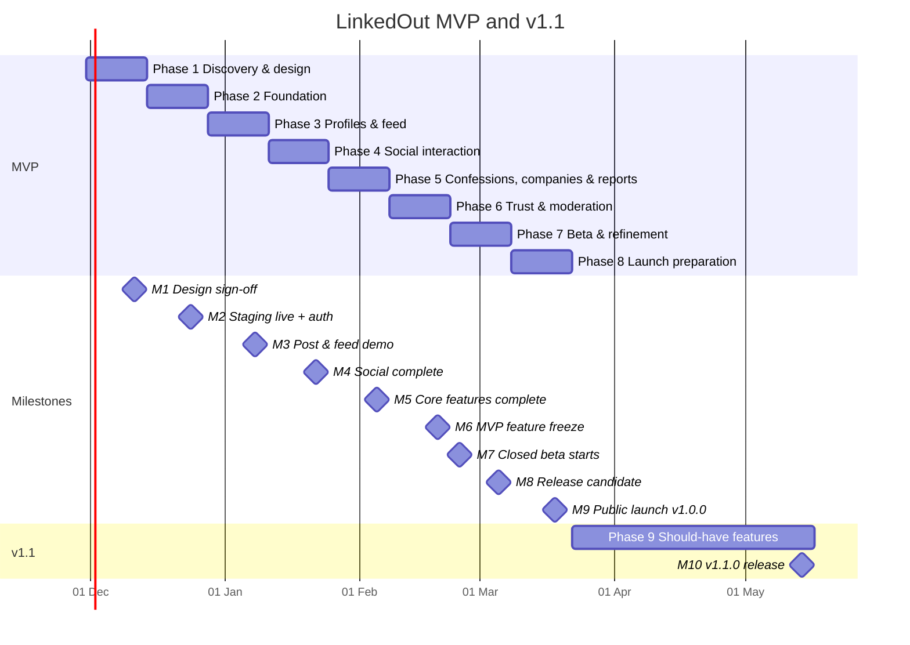

# LinkedOut — Roadmap

Based on plan §18 (12–16 weeks for a small team), using the 16-week upper bound because moderation and security work is substantial. The plan starts **Monday 30 November 2026** with a 2–3 person team (see [ASSUMPTIONS.md](ASSUMPTIONS.md#8-team-and-timeline)). Task-level detail is in [TASKS.md](TASKS.md).

## 1. Timeline

## 2. Phases

| Phase | Weeks | Dates | Goal | Key deliverables | Exit criteria | Est. hours |
|---|---|---|---|---|---|---|
| 1 Discovery & design | 1–2 | 30 Nov – 13 Dec 2026 | Shared understanding and safe policies before code | PRD and docs (done), Community Guidelines, Privacy Policy and Terms drafts, moderation SLAs, wireframes for all MVP screens, design tokens, usability test, accounts and repo | M1: wireframes and guidelines signed off by product owner and T&S lead | 49 |
| 2 Foundation | 3–4 | 14 – 27 Dec 2026 | A working, secure skeleton | Monorepo, CI and security scans, local infra, API skeleton, web shell, auth (register, verify, login, reset, sessions), onboarding, privacy settings, contract tests, staging deploy | M2: a user can register, verify, onboard and log in on staging; CI green | 134 |
| 3 Profiles & feed | 5–6 | 28 Dec 2026 – 10 Jan 2027 | People can present themselves and share stories | Anti-Profile, safety check core, posts (story/advice/lesson), categories, tags, content warnings, Latest feed, landing page | M3: Journey A part 1 E2E passes on staging | 93 |
| 4 Social interaction | 7–8 | 11 – 24 Jan 2027 | Conversation and support | Comments, reactions, saves, My Damage, block & mute, search (posts, lessons, members) | M4: comment/react/save/search flows pass E2E | 51 |
| 5 Confessions, companies & reports | 9–10 | 25 Jan – 7 Feb 2027 | Core differentiation | Identity Vault, Office Confessions (flag off in prod), reporting + moderation queue, Workplace Reality Pages with reviews and themes, Job Nightmare Board, extended search | M5: Journeys B and C work on staging; SEC-05 passes | 88 |
| 6 Trust & moderation | 11–12 | 8 – 21 Feb 2027 | Safe to open the doors | Moderation actions, appeals, campaign detection, identity reveal, admin dashboard, account deletion, retention jobs, full security suite, abuse testing | M6: feature freeze; all MVP stories accepted; zero critical/high security findings | 84 |
| 7 Beta & refinement | 13–14 | 22 Feb – 7 Mar 2027 | Validate with real users | Production environment, monitoring, backups and restore test, closed beta (50 → 150 invited students and early-career professionals), bug fixes, load tests, accessibility audit | M8: release candidate with beta success signals (TESTING §7) met or with an agreed plan | 48 |
| 8 Launch preparation | 15–16 | 8 – 21 Mar 2027 | Launch responsibly | Pentest and fixes, runbooks, policies published, launch gate, communications, v1.0.0 | M9: launch criteria (§4) all checked | 29 |
| 9 v1.1 Should-haves | 17–24 | 22 Mar – 16 May 2027 | Deepen community and engagement | Notifications, communities, polls, company representatives and responses, image posts, topic following, data export, Google sign-in | M10: v1.1.0 released; Should stories accepted | 102 |
| 10 Future | after v1.1 | — | Grow carefully | Spikes for F-31–F-43, prioritized by beta and launch metrics | Each spike produces a spec and a go/no-go | 39 (spikes) |

**Holiday risk:** Phases 2–3 overlap late December. Phase 7 carries a 1-week buffer: the beta can shrink to one week if earlier phases slip by up to 5 working days. A slip beyond that moves the launch, not the safety work.

## 3. Milestones

| ID | Milestone | Date | Owner | Evidence |
|---|---|---|---|---|
| M0 | Documentation set approved | Fri 27 Nov 2026 | Product owner | This docs folder; CHANGELOG v0.1.0 |
| M1 | Design & policy sign-off | Fri 11 Dec 2026 | Product owner, T&S lead | Wireframes, guidelines, privacy model approved |
| M2 | Staging live with authentication | Thu 24 Dec 2026 | Backend | Staging URL; TC-001–TC-012 green |
| M3 | Post & feed demo | Fri 8 Jan 2027 | Full team | E2E Journey A part 1 |
| M4 | Social interaction complete | Fri 22 Jan 2027 | Full team | TC-041–TC-048, TC-070–TC-072 green |
| M5 | Core differentiation complete | Fri 5 Feb 2027 | Full team | Journeys B and C on staging; SEC-05 green |
| M6 | MVP feature freeze | Fri 19 Feb 2027 | Product owner | All MVP stories accepted; security suite green |
| M7 | Closed beta starts | Wed 24 Feb 2027 | Product owner, T&S lead | v0.9.0-beta deployed; first 50 invites sent |
| M8 | Release candidate | Fri 5 Mar 2027 | Full team | Beta P1/P2 bugs closed; load tests passed |
| M9 | Public launch (v1.0.0) | Thu 18 Mar 2027 | Product owner | Launch criteria checked; confessions enabled |
| M10 | v1.1.0 release | Fri 14 May 2027 | Full team | Should features live; communities enabled |

## 4. MVP launch criteria

All items must be checked by the product owner and T&S lead before M9.

**Scope and quality**
- [ ] Every MVP feature (F-01, F-03–F-08, F-10–F-24) meets the acceptance criteria of its stories in [USER_STORIES.md](USER_STORIES.md).
- [ ] Zero open P1/P2 bugs; P3 bugs triaged with owners.
- [ ] Coverage thresholds in TESTING §2 met; E2E journeys A–C pass in Chromium, Firefox, WebKit and mobile viewports.
- [ ] Accessibility: axe shows 0 serious/critical violations on key screens; manual screen-reader audit fixes merged.

**Security and privacy (plan §18 Phase 7, §26)**
- [ ] Security review/pentest complete; 0 critical/high findings open.
- [ ] SEC-01–SEC-20 pass, especially SEC-05 (anonymous identity leakage) and SEC-11 (vault isolation).
- [ ] Reporting, moderation queue, actions, appeals, audit logging, identity reveal and block/mute are live in production **before** `confessions.enabled` is switched on.
- [ ] Privacy Policy, Terms and Community Guidelines published and linked in onboarding.
- [ ] Data deletion job verified end to end in staging; retention jobs scheduled.
- [ ] Secrets rotated from beta values; access review done.

**Operations**
- [ ] Backup restore tested within the last 30 days (logged).
- [ ] Monitoring dashboards and alerts verified with test alerts; on-call rota set.
- [ ] Runbooks written (DEPLOYMENT §11).
- [ ] Load tests passed at MVP targets (NFR-P1, NFR-P4); results recorded.
- [ ] Support, privacy, legal and security mailboxes monitored; `security.txt` live.
- [ ] Process for legal requests established with counsel.

**Trust and community**
- [ ] Moderator coverage confirmed for the first 14 days (rota, SLAs in PRD §8).
- [ ] Beta signals: trust survey ≥ 4.0/5, ≥ 50% find stories helpful, appeal reversal < 30%, or a documented mitigation plan for any miss.
- [ ] Seed content: ≥ 100 beta stories, ≥ 30 lessons, ≥ 20 companies with ≥ 5 reviews (so theme summaries render).

## 5. Release plan

| Version | Date | Contents |
|---|---|---|
| v0.1.0 | 27 Nov 2026 | Documentation set (this release) |
| v0.2.0 | 24 Dec 2026 | Foundation: auth, onboarding, privacy settings (staging only) |
| v0.3.0 | 8 Jan 2027 | Profiles, posts, feed (staging) |
| v0.4.0 | 22 Jan 2027 | Comments, reactions, saves, block/mute, search (staging) |
| v0.5.0 | 5 Feb 2027 | Confessions, companies, job nightmares, reporting (staging) |
| v0.6.0 | 19 Feb 2027 | Moderation actions, appeals, reveal, admin, deletion (staging) |
| v0.9.0-beta | 24 Feb 2027 | Closed beta in production (invite-only) |
| v1.0.0 | 18 Mar 2027 | Public launch |
| v1.1.0 | 14 May 2027 | Should-have features |

## 6. Post-launch metric review cadence

| Cadence | Review | Participants |
|---|---|---|
| Daily (first 2 weeks) | Moderation queue age, incidents, error rates | T&S lead, on-call engineer |
| Weekly | KPIs (PRD §8), guardrails, top feedback | Whole team |
| Monthly | Transparency metrics, restore test, rule list review, roadmap reprioritization for Future features | Whole team |
