# LinkedOut — Workflows

Step-by-step flows for every major action, with Mermaid flowcharts and the backend steps behind each. Endpoint details are in [API_SPEC.md](API_SPEC.md), and screen details in [UI_UX.md](UI_UX.md).

| # | Workflow | Features | Plan journey |
|---|---|---|---|
| W-01 | Sign up & verify email | F-01, F-03 | A (steps 3–4) |
| W-02 | Log in, lockout, log out | F-01 | B (step 1) |
| W-03 | Password reset | F-01 | — |
| W-04 | Onboarding | F-04 | A |
| W-05 | Edit Anti-Profile, privacy settings & change username | F-03, F-05, F-06 | — |
| W-06 | Create a post (story, advice, lesson) | F-10, F-16, F-21 | A (steps 5–9) |
| W-07 | Browse The Mess | F-11, F-07 | A (step 2) |
| W-08 | Comment, reply, pin clarification | F-12 | A (step 10) |
| W-09 | React | F-13 | — |
| W-10 | Save | F-14 | A (step 11) |
| W-11 | Office Confession | F-15, F-21, F-23 | B |
| W-12 | Research a company & write a review | F-17 | C |
| W-13 | Submit a company | F-17, F-24 | — |
| W-14 | Job Nightmare report | F-18 | — |
| W-15 | Search | F-19 | C (step 1) |
| W-16 | Block & mute | F-07 | — |
| W-17 | Report content | F-20 | — |
| W-18 | Moderation review & action | F-21 | — |
| W-19 | Appeal | F-22 | — |
| W-20 | Review campaign detection | F-21 | — |
| W-21 | Identity reveal (four-eyes) | F-23 | — |
| W-22 | Account deletion | F-08 | — |
| W-23 | Admin: company approval, merge, launch gate | F-24 | — |
| W-24 | Company representative verification & response (Should) | F-25 | D |
| W-25 | Communities (Should) | F-26 | — |
| W-26 | Notifications (Should) | F-27 | — |
| W-27 | Polls (Should) | F-28 | — |
| W-28 | Media upload (Should) | F-29 | — |
| W-29 | Data export (Should) | F-09 | — |
| W-30 | Google sign-in (Should) | F-02 | — |
| W-31 | Following feed (Should) | F-30 | — |
| W-32 | Error and edge cases | all | — |
| W-33 | Future feature flows (outline) | F-31–F-43 | — |

---

## W-01 — Sign up & verify email

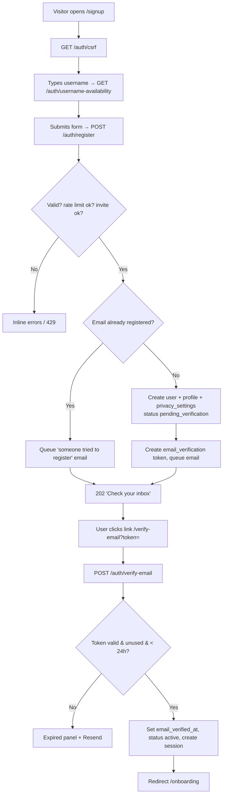

**Backend steps**
1. `AuthController.register` → Zod validation (email, password 12–128, username regex, `ageConfirmed`, `acceptTerms`).
2. Throttler `register` (5/h/IP). If `beta.invite_only`, the invite code is validated and its `used_count` incremented atomically.
3. `PasswordService.checkBreached` (HIBP range API, 2 s timeout, fail-open + log).
4. Username check against `profiles`, `reserved_usernames` and `username_history.reserved_until > now()`.
5. In one transaction: insert `users` (Argon2id hash, `terms_version`, `age_confirmed_at`), `profiles`, and `privacy_settings` (defaults).
6. `TokenService.create(email_verification, 24h)` stores the SHA-256 and enqueues the `email` job `VerifyEmail`.
7. Already-registered email: no DB writes; the `RegistrationAttempt` email is enqueued. Responses are identical (`202`).
8. Verify: look up the token by hash and check `used_at IS NULL AND expires_at > now()`. Then set `used_at`, `users.email_verified_at` and `account_status = active`, create a session (W-02 steps 6–8), and audit `auth.email_verified`.

## W-02 — Log in, lockout, log out

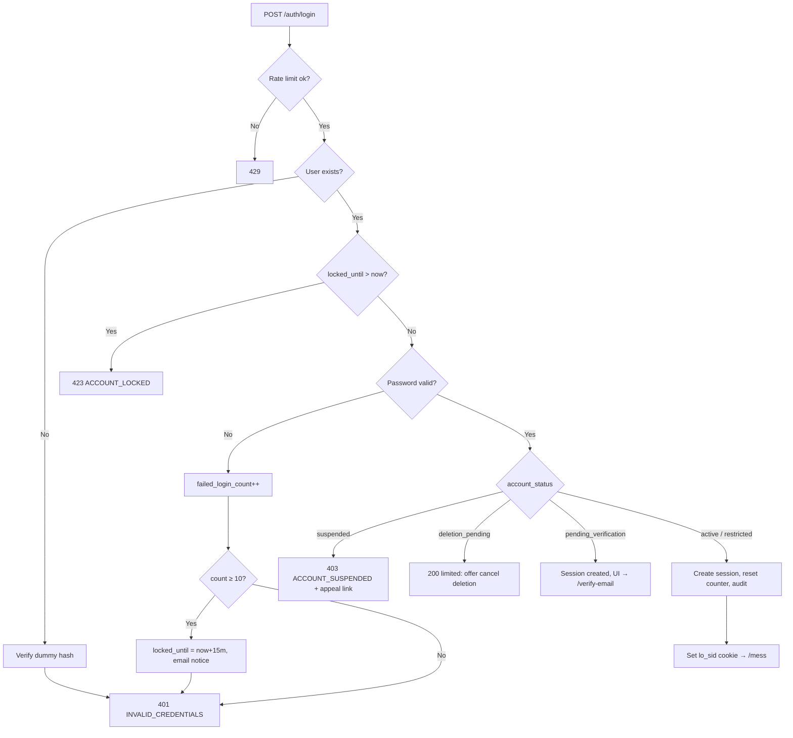

**Backend steps**
1. Normalize the email (lowercase via citext).
2. Argon2 verify (dummy-hash verification when the user is missing keeps timing equal).
3. On failure: increment `failed_login_count`; at 10, set `locked_until` and enqueue the `LoginLocked` email with a reset link; audit `auth.login_failed` (no password data).
4. On success: reset the counter, rehash if the Argon2 parameters changed, set `last_login_at`.
5. Create the session token (32 random bytes), insert `sessions` (device label from UA, approx location from GeoLite2), `SET sess:{hash}` with TTL, and add it to `user_sessions:{userId}`.
6. Audit `auth.login_succeeded`.
7. **Logout:** `DEL sess:{hash}`, set `sessions.revoked_at`, clear the cookie, audit `auth.logout`.

## W-03 — Password reset

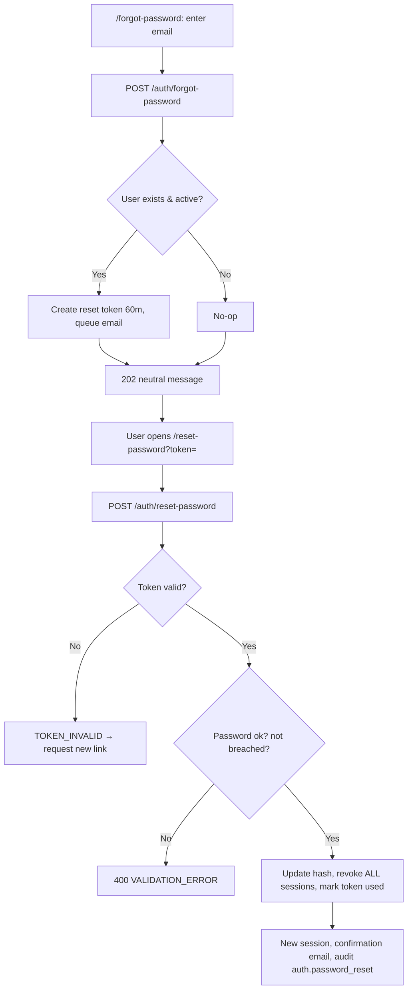

## W-04 — Onboarding

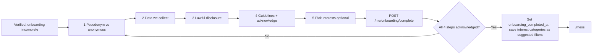

**Backend steps:** validate that `acknowledgedSteps` contains all 4 values. Set `users.onboarding_completed_at`. Store interest categories in `privacy_settings`-adjacent user preferences (local UI filter defaults returned in `GET /me`; follows are created only once F-30 ships). Audit `identity.onboarding_completed` with the guideline version.

## W-05 — Edit Anti-Profile, privacy settings & change username

1. Member opens S-25 → `GET /me`.
2. Edits fields → `PATCH /me/profile`. The server validates lengths and enums and runs `SafetyCheckService(context=profile)` on the headline and bio.
3. If there are medium findings without acknowledgement → `422 SAFETY_CONFIRMATION_REQUIRED`. The UI shows the findings, and the member confirms or edits.
4. Lessons, skills and timeline are saved with `PUT` replace semantics in one transaction (delete + insert with positions).
5. **Privacy settings (F-06):** S-26 → `GET /me/privacy` → change profile visibility, discoverability, default confession identity, default post visibility → `PATCH /me/privacy`. The server validates the enums and applies them on the next request. Profile reads (`GET /profiles/:username`), member search and composer defaults read these values. Audit `profile.privacy_changed`.
6. Username change → `PATCH /me/username`:

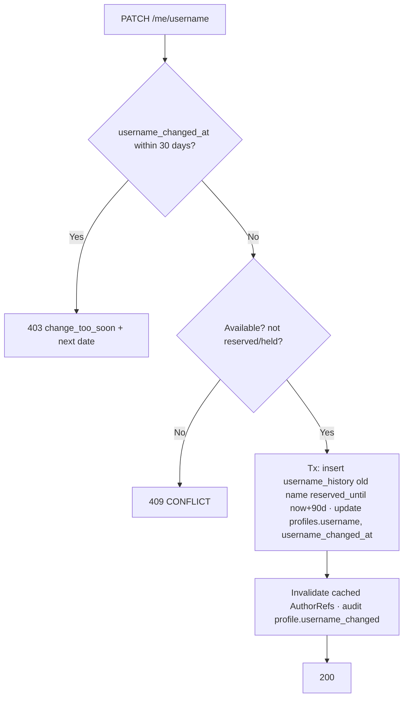

## W-06 — Create a post (story, advice, lesson)

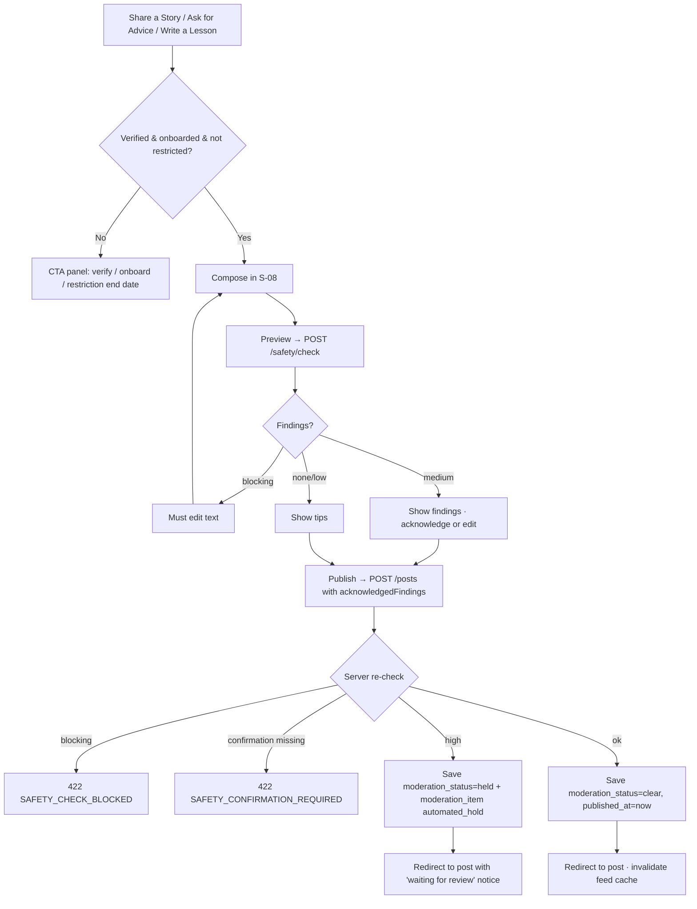

**Backend steps**
1. Guards: Session → CSRF → Verified → Throttler (`posts`: 10/h, 30/day).
2. Zod validation by `postType`. Lessons need `lesson.whatILearned`; the server composes `body` from the sections for search and excerpts.
3. Tags normalized (lowercase, hyphenated, max 40 chars) and upserted; `usage_count` incremented.
4. `SafetyCheckService.check(context, fields, author)` runs the rules from SECURITY §8.1 plus velocity rules for the author.
5. Insert `posts` (+ `lesson_details`, + `post_tags`) in one transaction. If held, upsert a `moderation_items` row (`automated_hold = true`, findings, priority from severity).
6. Emit `post.created`. Handlers invalidate `feed:v1:*`, enqueue `safety-scan` (post-publish re-scan), and later enqueue follower digests (F-30).
7. Return PostDetail (`moderationNotice` if held).

## W-07 — Browse The Mess

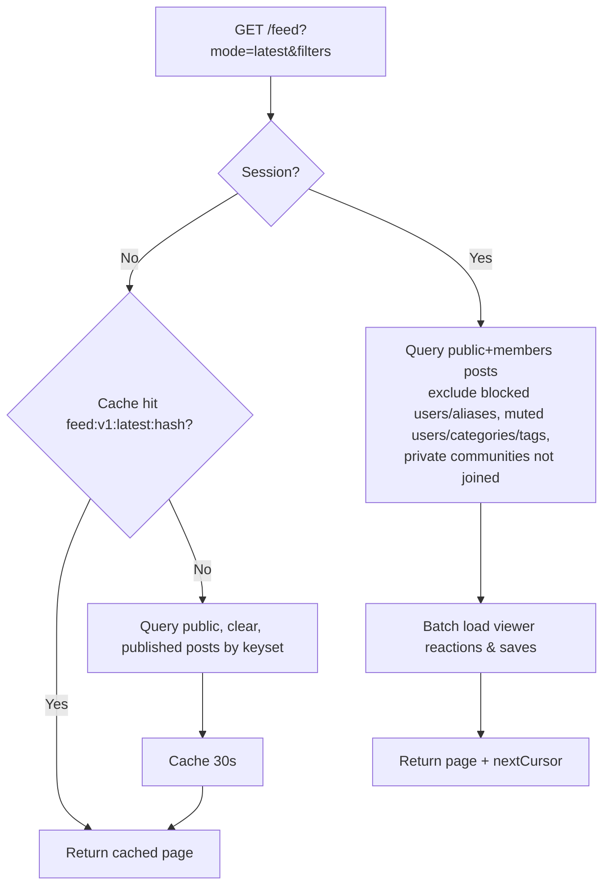

**Backend steps:** decode the cursor; `WHERE (published_at, id) < (:ts, :id)`; `LIMIT n+1` to compute `hasMore`; map rows through the PostSummary serializer (author: profile for pseudonym, label for anonymous); apply ContentWarning metadata (the UI collapses). Hidden categories for visitors come via `excludeCategory`.

## W-08 — Comment, reply, pin clarification

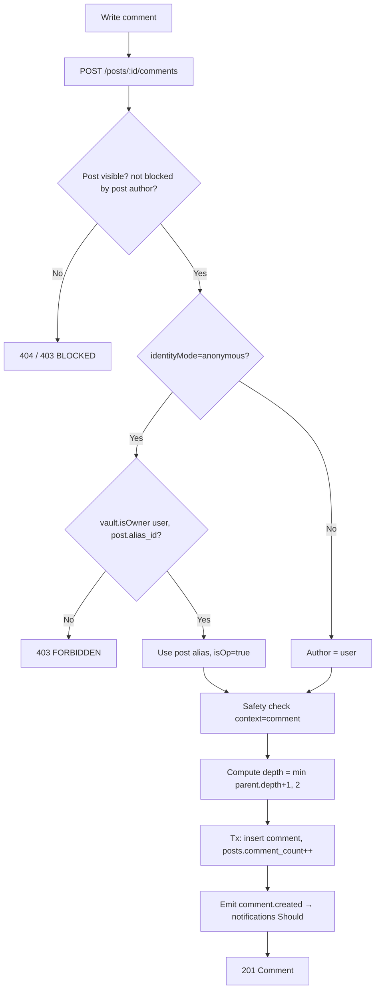

- **Edit:** `PATCH /comments/:id`. Owner check (user ID or vault for OP comments), safety re-check, `edited_at`.
- **Delete:** with replies → `deleted_at` set and the body shown as "[deleted]"; without replies → soft-deleted and hidden; `comment_count` decremented.
- **Pin clarification:** `PUT /posts/:id/pinned-comment` validates that the comment belongs to the post and was written by the post author (same user ID, or same alias for anonymous posts), then sets `posts.pinned_comment_id`.

## W-09 — React

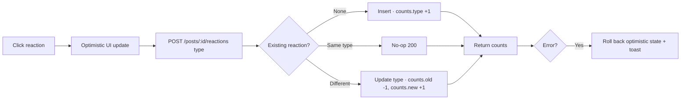

Backend: a single transaction with `SELECT … FOR UPDATE` on the reaction row and a `jsonb_set` counter update on `posts.reaction_counts`. Block check: if the post author blocked the reactor → `403 BLOCKED`. Toggle-off uses `DELETE`.

## W-10 — Save

`PUT /posts/:id/save` → `INSERT … ON CONFLICT DO NOTHING` into `saved_posts`. `DELETE` removes it. My Damage → Saved lists `GET /me/saved` (join with visibility checks; unavailable posts are flagged). Saves are never exposed publicly or counted.

## W-11 — Office Confession (Journey B)

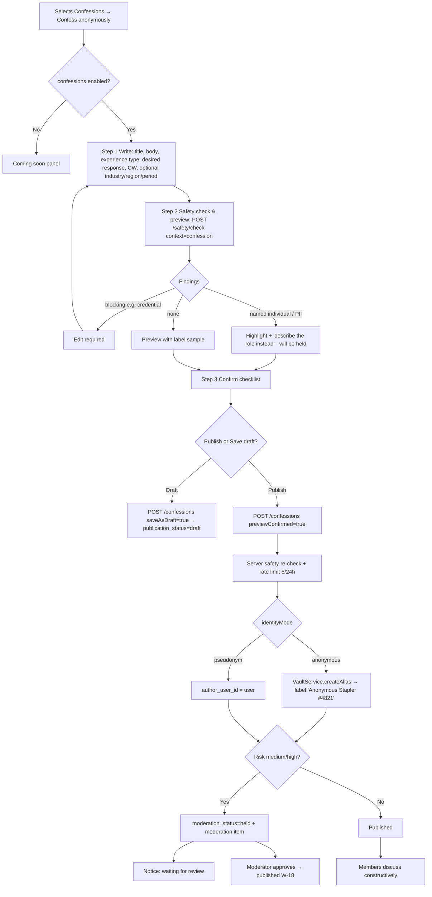

**Backend steps**
1. `@FeatureFlag('confessions.enabled')` guard.
2. Validation: required fields; `previewConfirmed = true` unless drafting; `periodQuarter` requires `periodYear`.
3. Safety check with `context=confession`. Any medium finding means hold (SECURITY §8.1).
4. Pre-generate the post UUIDv7. For anonymous mode, `VaultService.createAlias(userId, 'post', postId)` produces the label: a random pick from 60 office objects plus a random 4-digit number, unique among aliases (retry on collision).
5. Insert `posts` (`post_type=confession`, `identity_mode`, `author_user_id` NULL when anonymous, `alias_id`, `anonymous_label`) and `confession_details` in one transaction. On failure, delete the vault row (ARCHITECTURE §4.3).
6. If held, create a moderation item with priority by severity (named individual → normal, threats → high).
7. Logging: only `postId` and the outcome are logged. The user ID is never logged in this flow.
8. The response shows the AuthorRef `{kind:"anonymous", label}`. My Damage lists it via `vault.listOwnTargets(userId)`.
9. **Drafts:** `publication_status=draft`. The daily maintenance job sends the 7-day warning at 173 days of inactivity and deletes at 180 days (including the vault row).
10. **Corrections:** `POST /posts/:id/corrections` → ownership via vault → insert `post_corrections` (max 5).

## W-12 — Research a company & write a review (Journey C)

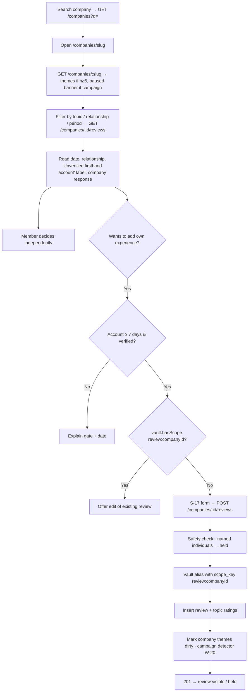

**Theme summary computation:** a maintenance job runs every 15 minutes for dirty companies. Per topic, it takes approved reviews (`moderation_status = clear`, not deleted, `published_at` within 24 months) and computes `n`, the median and the 1–5 distribution, storing them only when `n ≥ 5`. Non-consenting narratives still count.

## W-13 — Submit a company

1. Member searches and finds nothing → S-18 → `POST /companies`.
2. The server normalizes the name (lowercase, unaccent, strips legal suffixes) and extracts the registrable domain from the website.
3. Duplicate check on `normalized_name` and `website_domain` among pending/active companies → `409` with the existing company.
4. Insert `companies` (`page_status = pending`, `submitted_by_user_id`). Reviews and job reports referencing it are stored but unpublished.
5. Admin approves in S-31 (W-23). Attached clear content gets `published_at = now()`.

## W-14 — Job Nightmare report

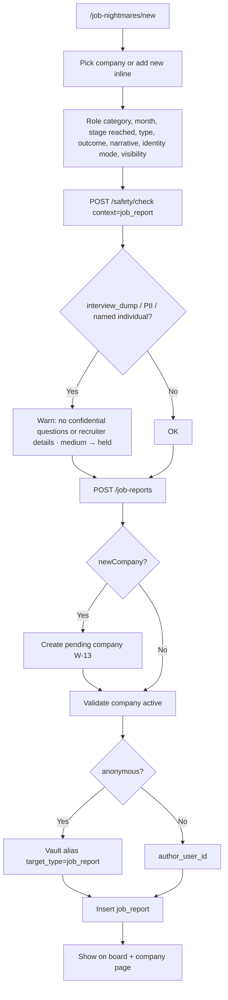

## W-15 — Search

1. `GET /search?q=&type=`; `q` is trimmed, 2–100 chars, and parsed with `websearch_to_tsquery('simple', unaccent(q))`.
2. Posts, lessons, confessions and job reports: `search_vector @@ query` with visibility/moderation/block/mute predicates, ranked by `ts_rank_cd` × recency decay (`1 / (1 + age_days/30)`).
3. Companies: `similarity(normalized_name, q) > 0.3` ordered by similarity, then `review_count`.
4. Members: username trigram, only `discoverable = true` and visibility ≠ hidden.
5. Highlights via `ts_headline` with `StartSel=<mark>, StopSel=</mark>` on escaped text.
6. `type=all` returns the top 5 per group; specific types are paginated with cursors (`rank|id`).

## W-16 — Block & mute

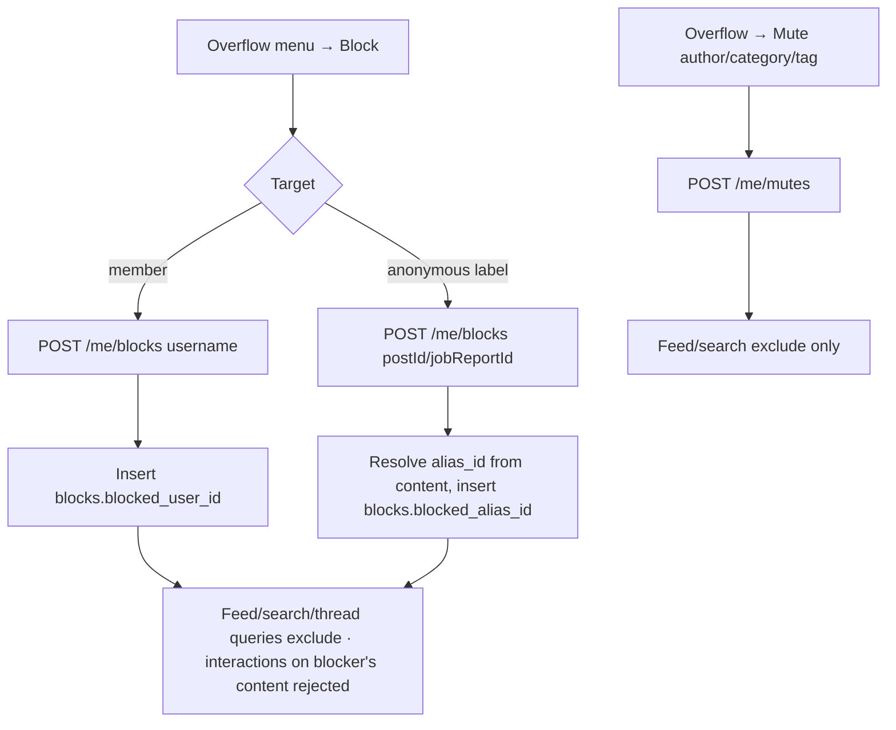

Rules: self-block → 400. Blocking an alias never queries the vault, because the alias ID is taken from the content row. Interaction checks run when the blocked party comments or reacts on the blocker's pseudonymous content; for the blocker's anonymous content, the vault resolves the owner internally.

## W-17 — Report content

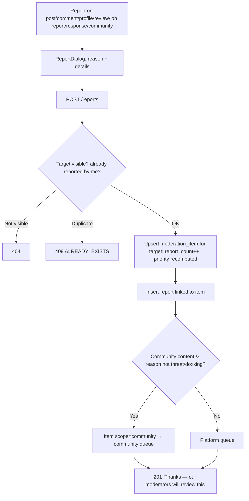

## W-18 — Moderation review & action

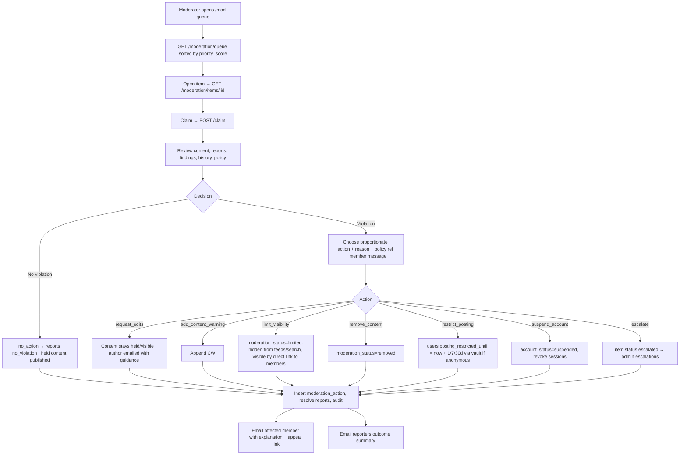

**Backend steps**
1. Claim sets `assigned_moderator_id` (conditional update `WHERE assigned_moderator_id IS NULL`) → `409` if it was taken in the meantime.
2. Action validation per type (API §15).
3. Transaction: apply the effect to the target, insert `moderation_actions`, update the item (`resolved`, or `escalated`), update reports (`actioned` / `no_violation`), audit `moderation.action_applied`.
4. For anonymous targets with account-level actions: `VaultService.resolveForEnforcement(aliasId)` returns the user ID inside the service and applies the restriction. Audit `vault.enforcement_resolved` (no identity is returned to the moderator).
5. Enqueue the `ModerationDecision` email to the affected member (the address is resolved internally) and `ReportOutcome` emails to reporters.

## W-19 — Appeal

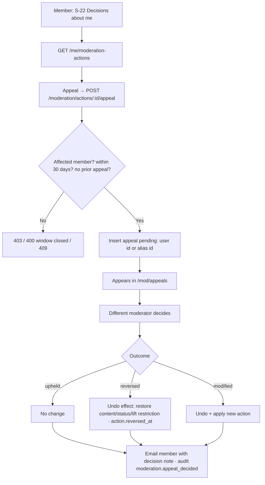

## W-20 — Review campaign detection

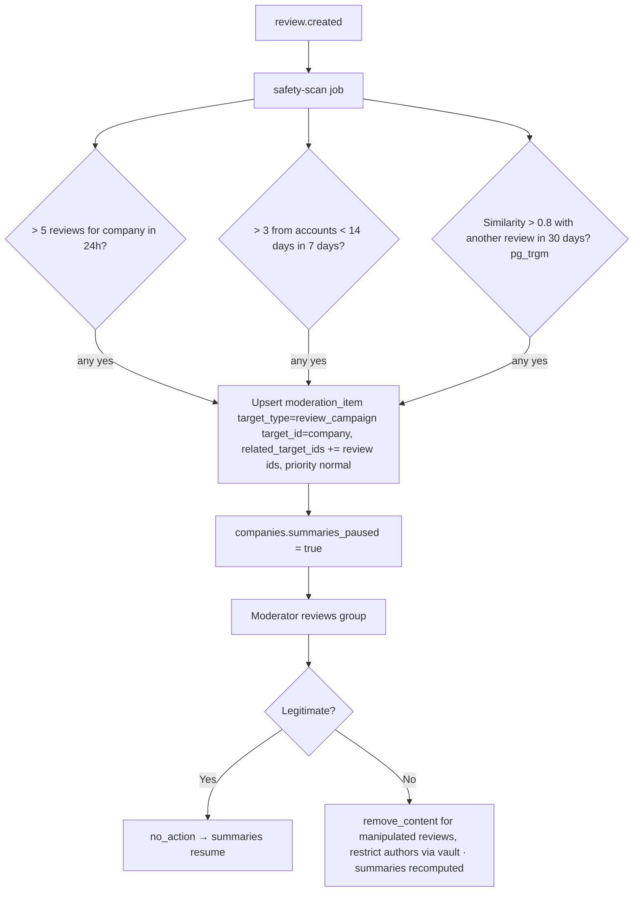

## W-21 — Identity reveal (four-eyes)

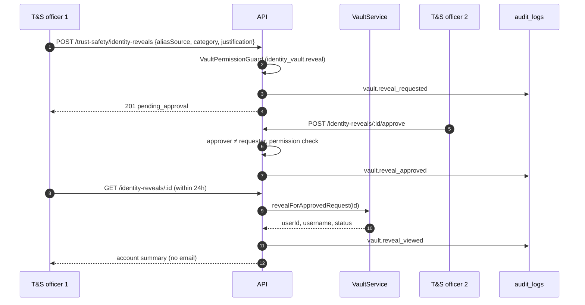

Unauthorized attempts are audit-logged (`vault.reveal_denied`) and trigger a Grafana alert.

## W-22 — Account deletion

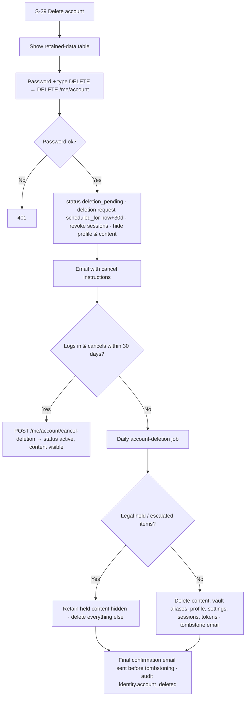

## W-23 — Admin: company approval, merge, launch gate

1. **Approve:** S-31 Companies → `PATCH /admin/companies/:id {pageStatus: active, websiteConfirmed}` → publishes attached clear reviews and reports → audit `admin.company_approved`.
2. **Merge:** `POST /admin/companies/:id/merge {intoCompanyId}`. In one transaction: move `workplace_reviews`, `job_reports`, `company_memberships`, `company_responses`; update the vault `scope_key` for moved reviews via `VaultService.rescopeReviews` (where duplicates collide, keep the newest review and hide the older one with `limit_visibility` and a note); set the source to `merged` with `merged_into_company_id`; recompute themes.
3. **Launch gate for confessions:** `PATCH /admin/feature-flags/confessions.enabled {enabled: true, launchGateConfirmed: true}` is allowed only when F-20, F-21, F-22 and F-23 are deployed and the ROADMAP launch criteria are checked; audit `admin.feature_flag_changed`.

## W-24 — Company representative verification & response (Should, Journey D)

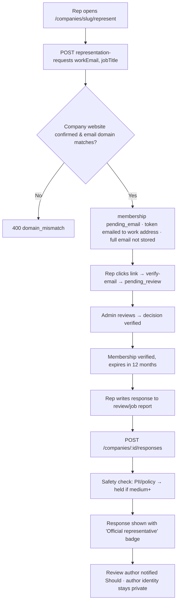

## W-25 — Communities (Should)

1. **Create:** `POST /communities` (age ≥ 14 days, ≤ 3 owned, ≥ 1 rule, coordinated-attack acknowledgement) → owner membership row.
2. **Join:** public → member immediately (`member_count++`); private → join request → a community moderator approves or declines (a declined member can retry after 30 days).
3. **Post:** the composer's community select → `visibility = community` for private communities, public communities keep public/members visibility → the post appears in the community feed (and in The Mess if the community is public).
4. **Moderate:** reports on community content create `scope = community` items → community moderators act (remove from community, add a content warning, ban from community). Threats and doxxing are mirrored to the platform queue.
5. **Leave:** delete the membership; the owner must transfer ownership first.

## W-26 — Notifications (Should)

```mermaid
flowchart TD
  A[Domain event e.g. comment.created] --> B[notifications queue job]
  B --> C{Recipient = actor? blocked? muted actor?}
  C -->|Yes| X[Drop]
  C -->|No| D{Type = reactions_on_post?}
  D -->|Yes| E[Upsert row by batch_key reactions:post:hour, actorCount++]
  D -->|No| F[Insert notification · is_sensitive if about recipient's anonymous content → encrypt reference]
  E & F --> G{Email enabled for type? or moderation_decision}
  G -->|No| H[In-app only]
  G -->|Yes| I{Quiet hours now?}
  I -->|Yes| J[Delay email job until quiet end]
  I -->|No| K[Send via email queue]
```

The web app polls `GET /notifications/unread-count` every 60 s while the tab is visible (Page Visibility API).

## W-27 — Polls (Should)

1. Create via `POST /posts {postType: poll, poll: {options 2–6, durationDays 1–14}}` → `polls.closes_at = published_at + duration`.
2. Vote: `POST /posts/:id/poll/votes` → insert `poll_votes` (PK prevents double votes) and increment `vote_count`/`total_votes` in one transaction.
3. Results are returned only after the viewer votes or the poll closes; individual votes are never exposed.

## W-28 — Media upload (Should)

```mermaid
flowchart LR
  A[Select image] --> B[Client checks type/size] --> C[POST /media/uploads purpose, mime, size, alt]
  C --> D[media row scan_status=pending · presigned PUT 10 min]
  D --> E[Browser PUT directly to R2 uploads/]
  E --> F[POST /media/:id/complete]
  F --> G[media-scan job: magic bytes → sharp re-encode, strip EXIF → ClamAV]
  G --> H{Clean?}
  H -->|Yes| I[Move to m/ prefix, scan_status=clean]
  H -->|No| J[Delete object, scan_status=infected, alert]
  I --> K[Attach to post via mediaIds]
```

## W-29 — Data export (Should)

`POST /me/exports` (password re-auth) → `data_export_requests` pending → the `data-export` job collects the profile, settings, posts (including own anonymous content via the vault), comments, reactions, saves, reports filed and moderation decisions about the member → writes JSON files → ZIP → uploads to `linkedout-exports/{exportId}.zip` → emails a 7-day presigned link → the lifecycle rule deletes it after 7 days.

## W-30 — Google sign-in (Should)

```mermaid
flowchart TD
  A[Continue with Google] --> B[GET /auth/oauth/google → state, nonce, PKCE cookie]
  B --> C[Google consent] --> D[Callback: validate state, exchange code, verify ID token]
  D --> E{oauth_accounts match?}
  E -->|Yes| F[Create session → /mess]
  E -->|No| G{users.email match?}
  G -->|Yes| H["/login?link=google: password confirm then link"]
  G -->|No| I["/signup/complete: username + policies → POST /auth/oauth/complete-signup"]
  I --> J[Create user email_verified_at=now, profile, oauth link, session → onboarding]
```

## W-31 — Following feed (Should)

`GET /feed?mode=following` → posts where `category_id IN followed categories OR EXISTS post_tags in followed tags OR community_id IN joined communities`, with the same exclusions as W-07, ordered by `published_at`. Empty → suggestions from `GET /categories`.

---

## W-33 — Future feature flows (outline, detailed during each spike)

These flows set the intended shape and the safety rules each Future feature must keep. Each is detailed in its Phase 10 spike ([TASKS.md](TASKS.md)).

| Feature | Flow outline | Backend steps | Non-negotiable rules |
|---|---|---|---|
| F-31 Direct Messaging | Member opens a pseudonymous profile → "Message" → if the recipient allows `requests_only`, a message request is sent → the recipient accepts or declines → the conversation opens; block or report from the thread. | Check `privacy_settings.message_permissions` and blocks → insert `message_requests` → on accept create `conversations` + members → `messages` inserts rate-limited (20/10 min) → safety check per message → notification. | Anonymous labels are never messageable; no attachments in v1; safety notice on the first message; admins cannot browse messages. |
| F-32 Career Damage Report | Member opens My Damage → Report → adds tracked applications and goals → sees private counts and progress notes. | CRUD on `career_applications`, `career_goals` (owner only) → aggregate counts on read. | Never public, never in exports to third parties, no mental-health inference, no ranking. |
| F-33 Meme Generator | Choose template → add text → preview (safety check on text) → export PNG or share as a `meme` post. | `GET /meme-templates` → `POST /memes` renders server-side with sharp → creates `media` (clean) → optional `POST /posts` type `meme`. | PII/harassment checks on overlay text; templates admin-curated; no faces of real private individuals. |
| F-34 Hall of Shame | Moderator nominates a recurring pattern from anonymized moderated stories → editorial review → publish a pattern highlight linking to example posts (with consent of pseudonymous authors). | `hall_of_shame_entries` created by moderators → admin approval → public listing. | Patterns only; never names individuals or employees; not a leaderboard. |
| F-35 Relevant feed | Member switches to Relevant → ranked feed → one click back to Latest. | Candidate generation (last 14 days) → score = topic match × recency decay × meaningful-reply factor × diversity penalty → cache per user for 5 min. | No anger/controversy signals; no sensitive attributes; repeated distressing content is down-weighted. |
| F-36 AI-assisted categorization | Composer suggests a category and content warnings → author accepts or ignores. | `POST /safety/suggest` calls the model with text only (no identity) → returns suggestions → nothing is stored unless the author accepts. | Suggestions only; never auto-moderates; provider DPA and EU processing required. |
| F-37 Premium | Member views plans → checkout via a billing provider → premium features unlocked. | Billing webhook → `subscriptions` row → entitlement checks in guards. | Safety and privacy features never paywalled; payment identity never linked to anonymous content. |
| F-38 Employer analytics | Verified representative opens Analytics → sees aggregated theme trends. | Nightly aggregates over approved reviews and job reports → suppress segments with < 10 contributors. | k-anonymity ≥ 10; no individual content beyond what is public; no suppression tools. |
| F-39 MFA | Member enables TOTP → scans QR → confirms code → saves recovery codes → login asks for a code. | `mfa_factors` with encrypted secret → `POST /auth/login` returns `mfa_required` → `POST /auth/login/mfa`. | Mandatory for staff roles once shipped. |
| F-40 Mobile apps | Same journeys as web, with native navigation. | Same `/api/v1`; session cookie via secure native storage. | Same privacy rules; no extra trackers. |
| F-41 Learning paths | Member starts a path → completes steps (curated lessons and resources) → progress saved privately. | `learning_paths`, `learning_path_steps`, `learning_progress`. | Progress is private. |
| F-42 Push notifications | Member enables push → browser/device subscription stored → notifications delivered respecting preferences and quiet hours. | `push_subscriptions` → the `notifications` processor fans out to the Web Push/APNs/FCM provider. | Same non-manipulative copy rules; no anonymous labels in push text. |
| F-43 Survivor events | Community moderator creates an online event → members RSVP as pseudonym or as an anonymous count → reminder notification → event happens on an external moderated platform. | `events`, `event_rsvps` → reminder jobs. | Attendee lists show pseudonyms only by opt-in. |

---

## W-32 — Error and edge cases

| Scenario | Expected behavior | Where handled |
|---|---|---|
| Session expired mid-compose | API returns 401; the web app keeps the draft in local storage, opens the login dialog, retries the submit after login | `lib/api/client.ts`, composer autosave |
| CSRF token missing/rotated | 403 CSRF_INVALID → client fetches `/auth/csrf` once and retries | API client |
| Double submit (double click, retry) | `Idempotency-Key` returns the original 201 response | Idempotency interceptor |
| Post deleted while viewing | Actions return 404/410 → toast "This post is no longer available" | API + UI |
| Comment on a post that became held/removed | 404 | engagement service |
| Reply to a deleted comment | Allowed if the parent row exists (soft-deleted); shown under "[deleted]" | engagement service |
| Reaction when blocked by the author | 403 BLOCKED with a generic message | engagement service |
| Username changed between page loads | Old `/u/old` → 404; post AuthorRefs already show the new name | profile service |
| Member restricted while writing | 403 POSTING_RESTRICTED with an `until` date → banner | VerifiedGuard |
| Account suspended with active sessions | Sessions revoked; next request 401 → login shows the suspension page with an appeal link | moderation service |
| Vault DB unavailable | Confession/review/anonymous job report creation → 503; pseudonymous features continue | VaultService health |
| Redis unavailable | Authenticated requests 503; visitor reads served from the DB | SessionGuard, throttler |
| Email provider failure | Jobs retry 5× with backoff; the user can resend verification after 60 s | email processor |
| Safety rules updated after publish | Post-publish `safety-scan` may create a moderation item; content stays visible unless high severity (then auto-limited pending review) | safety-scan processor |
| Company merged while writing a review | Submit to the old ID → 301-equivalent: API 409 with `details.mergedInto`; the UI redirects | company service |
| Pending company approved later | Attached content is published at approval time | admin service |
| Duplicate report | 409 ALREADY_EXISTS → UI "You've already reported this" | moderation service |
| Moderator tries to appeal-decide own action | 403 `same_moderator` | moderation service |
| Two moderators claim the same item | Second gets 409 → UI refreshes the assignee | moderation service |
| Reveal requested without permission | 403 + audit `vault.reveal_denied` + alert | VaultPermissionGuard |
| Deletion requested with open escalation | Escalated content retained (hidden) until resolved; everything else deleted | deletion processor |
| Draft reaches 180 days | Deleted with its vault row; a reminder was sent at 173 days | maintenance job |
| Poll vote after closing | 400 `poll_closed` | content service |
| Upload infected | Object deleted, `scan_status = infected`, user sees "This file couldn't be used", security alert | media-scan processor |
| Feed cursor from an old deploy | Invalid cursor → 400 INVALID_CURSOR → client restarts from page 1 | feed service |
| Network offline | TanStack Query pauses mutations; banner "You're offline — we'll retry when you're back" | web |
