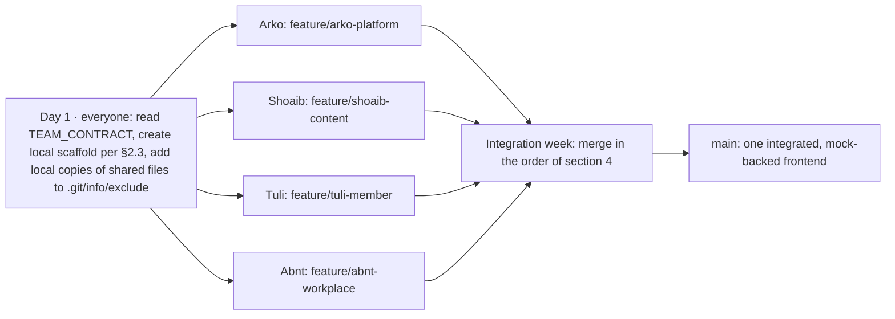

# LinkedOut Frontend Team Plan

**Phase:** frontend only, with mock data (no backend work).
**Team:** Arko · Shoaib · Tuli · Abnt.
**Start:** everyone starts on day 1 in parallel. **Nobody waits for anybody.**

| File | Purpose |
|---|---|
| [TEAM_CONTRACT.md](TEAM_CONTRACT.md) | The binding agreement: stack, folder ownership, tokens, types, routes, base components, mock pattern, state, naming, git rules, Definition of Done |
| [arko.md](arko.md) | Platform, authentication, account, moderation |
| [shoaib.md](shoaib.md) | The Mess, posts, comments, reactions, lessons, search, notifications |
| [tuli.md](tuli.md) | Base UI kit, safety components, confessions, profile, privacy, My Damage, reports, legal |
| [abnt.md](abnt.md) | Companies, job nightmares, communities, admin |

---

## 1. Who owns what

| Teammate | Modules / pages owned | Folders owned (under `apps/web/`) | Est. hours |
|---|---|---|---|
| **Arko** | Scaffold & config, shared types/routes/flags/mock helpers/session, app shell & navigation, S-02 Sign up, S-02b OAuth completion, S-03 Log in, S-04 Verify email, S-05 Forgot/Reset, S-06 Onboarding, S-27 Sessions, S-29 Account & data, S-38 System pages, S-23 Moderator queue + appeals, S-24 Moderation item + reveal | root config files, `public/`, `src/middleware.ts`, `src/styles/`, `src/shared/`, `src/components/layout/`, `src/app/{layout,providers,not-found,error}.tsx` + `globals.css`, `src/app/(auth)/`, `src/app/onboarding/`, `src/app/maintenance/`, `src/app/suspended/`, `src/app/mod/`, `src/app/(app)/layout.tsx`, `src/app/(app)/settings/{layout.tsx,page.tsx,sessions/,account/}`, `src/features/{auth,onboarding,account,system,moderation}/`, `tests/e2e/platform/` | **104** |
| **Shoaib** | S-01 Landing, S-07 The Mess (Latest + Following), S-08 Composer (story/advice/lesson/poll/images), S-11 Post detail + comments + reactions + saves + corrections + polls, S-14 Learned the Hard Way, S-21 Search, S-36 Notification center + bell, S-37 Notification settings; exports PostCard, ContentWarningGate, MarkdownRenderer, REACTIONS, NotificationBell | `src/app/(marketing)/page.tsx`, `src/app/(app)/{mess,post,posts,lessons,search,notifications}/`, `src/app/(app)/settings/notifications/`, `src/features/{posts,comments,feed,lessons,search,notifications}/`, `tests/e2e/content/` | **100** |
| **Tuli** | Base UI kit + `/dev/ui`, SafetyCheckPanel, ReportDialog, BlockMuteMenuItems, S-09 Confession wizard, S-10 Confessions list, S-12 Public Anti-Profile, S-13 My Damage, S-22 Report & appeal center, S-25 Settings → Profile (+ avatar, username), S-26 Privacy, S-28 Blocked & muted, Legal pages | `components.json`, `src/components/ui/`, `src/app/dev/ui/`, `src/app/(marketing)/legal/`, `src/app/(app)/{confessions,u,me,reports}/`, `src/app/(app)/settings/{profile,privacy,blocked}/`, `src/features/{safety,confessions,profile,privacy,my-damage,reports,legal}/`, `tests/e2e/member/` | **94** |
| **Abnt** | S-15 Company directory, S-16 Workplace Reality Page, S-17 Review form, S-18 Submit company, S-32 Representative request + company responses, S-19 Job Nightmare Board + detail, S-20 Job report form, S-33 Communities, S-34 Community page + moderation tab, S-35 Create community, S-30 Admin dashboard, S-31 Admin sub-pages; exports CompanyCard, JobReportCard, CommunityCard | `src/app/(app)/{companies,job-nightmares,communities}/`, `src/app/admin/`, `src/features/{companies,job-nightmares,communities,admin}/`, `tests/e2e/workplace/` | **96** |
| **Total** | | | **394** (average 98.5 h; all within ±10%: 88.7–108.4 h) |

The workload is mixed on purpose. Each person has one "infrastructure-like" piece (Arko the platform, Tuli the UI kit and safety components, Shoaib the reusable content cards, Abnt the admin data tables), at least one complex form flow (Arko onboarding + moderation action form, Shoaib the composer, Tuli the confession wizard, Abnt the review and job report forms), and plenty of list and detail pages.

---

## 2. Feature coverage (every frontend feature → exactly one owner per deliverable)

Features come from [FEATURES.md](../FEATURES.md). "Deliverable" is a screen or component; each deliverable has exactly one owner.

| Feature | Frontend deliverables → owner |
|---|---|
| F-01 Accounts & Authentication | S-02 Sign up, S-03 Log in, S-04 Verify email, S-05 Forgot/Reset, S-27 Sessions → **Arko** |
| F-02 OAuth Sign-in (Should) | S-02b, Google buttons → **Arko** |
| F-03 Public Pseudonym & Identity Separation | Username choice at sign-up (in S-02) → **Arko** · Username change (in S-25) → **Tuli** · `AuthorBadge` anonymous/member rendering (kit) → **Tuli** |
| F-04 Onboarding & Privacy Explanation | S-06 → **Arko** |
| F-05 Anti-Profile | S-12 Public Anti-Profile, S-25 Settings → Profile → **Tuli** |
| F-06 Privacy Settings | S-26 → **Tuli** |
| F-07 Block & Mute | `BlockMuteMenuItems`, S-28 → **Tuli** · "Hide this category" feed control → **Shoaib** |
| F-08 Account Deletion | S-29 delete section → **Arko** |
| F-09 Data Export (Should) | S-29 export section → **Arko** |
| F-10 Posts, Categories, Tags & Content Warnings | S-08 Composer, S-11 Post detail, `ContentWarningGate`, `MarkdownRenderer`, `PostCard` → **Shoaib** |
| F-11 The Mess — Latest Feed & Filters | S-07, S-01 Landing preview → **Shoaib** |
| F-12 Comments | `CommentThread`, `CommentForm`, pinned clarification → **Shoaib** |
| F-13 Reactions | `ReactionBar` → **Shoaib** |
| F-14 Saved Posts | `SaveButton` → **Shoaib** · Saved tab in S-13 → **Tuli** |
| F-15 Office Confessions | S-09, S-10 → **Tuli** |
| F-16 Learned the Hard Way | Lesson composer mode (S-08), S-14 → **Shoaib** |
| F-17 Workplace Reality Pages | S-15, S-16, S-17, S-18 → **Abnt** |
| F-18 Job Nightmare Board | S-19 (+ detail), S-20 → **Abnt** |
| F-19 Search | S-21 → **Shoaib** |
| F-20 Content Reporting | `ReportDialog`, S-22 "Reports I made" → **Tuli** |
| F-21 Automated Safety Checks & Moderation Queue | `SafetyCheckPanel`/`useSafetyCheck` → **Tuli** · S-23 queue, S-24 item + ActionForm → **Arko** |
| F-22 Appeals | Member appeal (S-22 "Decisions about me") → **Tuli** · Moderator appeals tab → **Arko** |
| F-23 Audit Logging & Identity Vault | RevealPanel (S-24) → **Arko** · Admin audit log page (S-31) → **Abnt** |
| F-24 Admin Dashboard | S-30, S-31 users/categories/companies/escalations/flags/invites → **Abnt** |
| F-25 Company Representatives & Responses (Should) | S-32, response editor/display, admin Representatives page → **Abnt** |
| F-26 Communities (Should) | S-33, S-34 (+ moderation tab), S-35 → **Abnt** |
| F-27 Notifications (Should) | `NotificationBell`, S-36, S-37 → **Shoaib** |
| F-28 Polls (Should) | Poll composer mode, `PollCard` → **Shoaib** |
| F-29 Image & Meme Posts (Should) | `ImagePicker` for posts → **Shoaib** · `AvatarUploader` (S-25) → **Tuli** |
| F-30 Topic Following (Should) | Following tab, `FollowButton`, suggestions → **Shoaib** |
| Shared platform | Scaffold, tokens, types, routes, flags, mock helpers, session, guards, app shell, S-38 → **Arko** |
| Shared UI | Base kit, `/dev/ui` → **Tuli** |
| Legal | `/legal/*` pages → **Tuli** |
| F-31 – F-43 (Future) | Not in this phase. Future owners when scheduled: F-31 DMs → Tuli · F-32 Career Damage Report → Tuli · F-33 Meme generator → Shoaib · F-34 Hall of Shame → Abnt · F-35 Relevant feed → Shoaib · F-36 AI suggestions → Shoaib · F-37 Premium → Arko · F-38 Employer analytics → Abnt · F-39 MFA → Arko · F-40 Mobile → Arko · F-41 Learning paths → Tuli · F-42 Push → Shoaib · F-43 Events → Abnt |

### 2.1 Screen coverage (UI_UX inventory S-01 – S-38)

| Owner | Screens |
|---|---|
| Arko | S-02, S-02b, S-03, S-04, S-05, S-06, S-23, S-24, S-27, S-29, S-38 |
| Shoaib | S-01, S-07, S-08, S-11, S-14, S-21, S-36, S-37 |
| Tuli | S-09, S-10, S-12, S-13, S-22, S-25, S-26, S-28 |
| Abnt | S-15, S-16, S-17, S-18, S-19, S-20, S-30, S-31, S-32, S-33, S-34, S-35 |

That is 39 screens (38 + S-02b); each appears once.

### 2.2 User story coverage (US-001 – US-075 assigned once; US-076 – US-088 are Future)

| Owner | Stories |
|---|---|
| Arko | US-005, US-006, US-007, US-008, US-009, US-010, US-011, US-013, US-020, US-021, US-060, US-061, US-062, US-063, US-064, US-065, US-066 |
| Shoaib | US-001, US-002, US-004, US-022, US-023, US-024, US-025, US-026, US-027, US-028, US-029, US-030, US-031, US-032, US-036, US-037, US-038, US-044, US-052, US-053, US-054, US-055, US-056, US-057 |
| Tuli | US-012, US-014, US-015, US-016, US-017, US-018, US-019, US-033, US-034, US-035, US-045, US-046, US-047 |
| Abnt | US-003, US-039, US-040, US-041, US-042, US-043, US-048, US-049, US-050, US-051, US-058, US-059, US-067, US-068, US-069, US-070, US-071, US-072, US-073, US-074, US-075 |
| Future (owners in §2) | US-076 – US-088 |

---

## 3. How we work in parallel

1. **Day 1 (≈ 1 hour each):** read the contract; generate the scaffold locally with the exact commands in contract §2.3; create local copies of the shared-contract files you don't own (types verbatim from §5, minimal base components with §8 props, simple placeholders for cross-feature components); add them to `.git/info/exclude`. Arko commits the real scaffold to `main` the same day, but nobody needs to pull it.
2. **Every day:** work only inside your folders on your own branch. Your mock services make every page fully functional on its own. Use `?mock=empty|error|slow|forbidden` and the dev role switcher to show every state.
3. **Weekly 30-minute sync (no blocking):** demo progress, raise contract questions. A change to the contract needs a PR approved by all four. Because shapes are agreed, changes should be rare.
4. **Dependency requests:** if you need a new npm package, add a row below instead of editing `package.json`. Arko installs it during integration. Until then, implement without it.

### 3.1 Dependency requests

| Requested by | Package | Why | Status |
|---|---|---|---|
| — | — | No requests yet. All packages needed for the documented scope are already in contract §2.3. | — |

---

## 4. Merge plan (integration week)

Each step is a PR into `main` reviewed by another teammate. The order only matters for the integration week itself; nobody's feature work depends on it.

1. **Arko → `main`:** scaffold (already there), `src/shared/**`, `src/components/layout/**`, root files, Arko's features. Everyone else then **deletes their local copies of these paths** and rebases.
2. **Tuli → `main`:** `src/components/ui/**`, safety components, Tuli's features. Everyone deletes local kit and safety copies and rebases.
3. **Shoaib → `main`:** content features and cross-feature exports. Others delete their PostCard/NotificationBell placeholders and rebase.
4. **Abnt → `main`:** workplace, communities, admin. Shoaib deletes the CompanyCard/JobReportCard/CommunityCard placeholders.
5. Run the final integration checklist (§5) on `main`.

Conflicts are impossible by construction, because no two people own the same file. If `git` reports one, someone committed outside their ownership. That change is reverted and redone by the owner.

---

## 5. Final integration checklist

**Shared code**
- [ ] All local copies deleted; `git status --ignored` shows no excluded shared-contract paths in anyone's checkout.
- [ ] `pnpm typecheck` passes on `main` (proves every placeholder matched the contract's types and props).
- [ ] ESLint `no-restricted-imports` rule enabled; zero violations (no feature imports another feature's internals).

**Layouts and routes**
- [ ] Every route in contract §6 renders inside the correct layout (`(app)` shell, wide layout for `/mod` and `/admin`, no shell for `(auth)` and onboarding).
- [ ] Navigation items, the Share menu and the mobile tab bar link to the right pages via `routes.*`; role- and flag-gated items appear only for the right mock users.
- [ ] `PageAside` content (The Mess) appears at `xl`.
- [ ] `NotificationBell` is in TopNav and shows the unread count for members.
- [ ] Guards: visitor redirects, unverified banners, onboarding redirect, moderator/admin 404s all verified with the dev role switcher.

**Shared components**
- [ ] `/dev/ui` reviewed together; any screen still using a crude look has been re-checked with the real kit.
- [ ] `PostCard` renders correctly in feed, lessons, search, profile, My Damage, confessions and community feed.
- [ ] `SafetyCheckPanel` works in the composer, comments, confession wizard, profile bio, review form, job report form and company response editor.
- [ ] `ReportDialog` and `BlockMuteMenuItems` work from posts, comments, profiles, reviews, job reports and communities.
- [ ] `CompanyCard`, `JobReportCard`, `CommunityCard` render in search.

**Cross-feature links (canonical fixtures, contract §7.3)**
- [ ] Confession "View it" → post detail; moderation item 1 → confession post 33; community feed posts → post detail; search results → each owner's page; admin escalations → `/mod/items/[id]`; decision cards → `/legal/guidelines#cg-x-y`.

**Quality gates**
- [ ] `pnpm lint`, `pnpm typecheck`, `pnpm test`, `pnpm build` green.
- [ ] All four E2E suites (`tests/e2e/{platform,content,member,workplace}`) green on chromium and mobile-chrome.
- [ ] axe: 0 serious/critical violations on every route.
- [ ] Manual pass at 360 / 768 / 1280 px on every route; no console errors.
- [ ] Every personal task list is fully ticked; [../CHANGELOG.md](../CHANGELOG.md) has an entry per slice.

**Ready for the real API (later phase)**
- [ ] Each feature's `api/index.ts` is the only place that references `mock<Feature>Api`.
- [ ] The integration-notes tables in the four personal files are complete and match [../API_SPEC.md](../API_SPEC.md).
